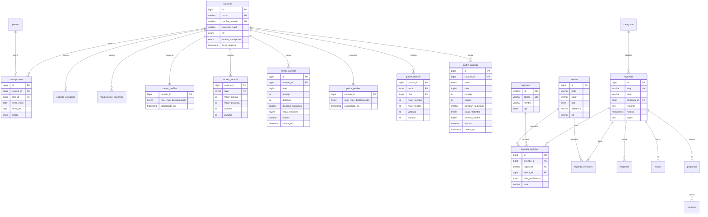

# Esquema de base de datos — MVP

Borrador para revisión del autor. MySQL 8 o superior, InnoDB, `utf8mb4`. Ya aplicado y verificado en MySQL 9.7 local.

Si cambias el DDL, crea una migración nueva en `server/db/migrations/`; no edites una migración ya aplicada.

Recorte aplicado: sin `municipios`, sin `materiales_educativos` y sin respuestas o progreso por usuario, salvo el progreso del runner (M11) y el de El Padre sin Cabeza (M12).

## Diagrama



## DDL

```sql
CREATE TABLE regiones (
  id SMALLINT UNSIGNED NOT NULL AUTO_INCREMENT,
  codigo VARCHAR(20) NOT NULL,
  nombre VARCHAR(100) NOT NULL,
  tipo ENUM('departamento', 'region_autonoma') NOT NULL,
  PRIMARY KEY (id),
  UNIQUE KEY uq_regiones_codigo (codigo),
  UNIQUE KEY uq_regiones_nombre (nombre)
) ENGINE=InnoDB DEFAULT CHARSET=utf8mb4 COLLATE=utf8mb4_unicode_ci;

CREATE TABLE categorias (
  id SMALLINT UNSIGNED NOT NULL AUTO_INCREMENT,
  slug VARCHAR(50) NOT NULL,
  nombre VARCHAR(100) NOT NULL,
  PRIMARY KEY (id),
  UNIQUE KEY uq_categorias_slug (slug),
  UNIQUE KEY uq_categorias_nombre (nombre)
) ENGINE=InnoDB DEFAULT CHARSET=utf8mb4 COLLATE=utf8mb4_unicode_ci;

CREATE TABLE usuarios (
  id BIGINT UNSIGNED NOT NULL AUTO_INCREMENT,
  correo VARCHAR(254) NOT NULL,
  nombre_usuario VARCHAR(50) NOT NULL,
  password_hash VARCHAR(255) NOT NULL,
  rol ENUM('gratis', 'premium', 'admin') NOT NULL DEFAULT 'gratis',
  estado_suscripcion ENUM('gratis', 'premium') NOT NULL DEFAULT 'gratis',
  fecha_registro TIMESTAMP NOT NULL DEFAULT CURRENT_TIMESTAMP,
  actualizado_en TIMESTAMP NOT NULL DEFAULT CURRENT_TIMESTAMP ON UPDATE CURRENT_TIMESTAMP,
  PRIMARY KEY (id),
  UNIQUE KEY uq_usuarios_correo (correo),
  UNIQUE KEY uq_usuarios_nombre (nombre_usuario)
) ENGINE=InnoDB DEFAULT CHARSET=utf8mb4 COLLATE=utf8mb4_unicode_ci;

CREATE TABLE planes (
  id SMALLINT UNSIGNED NOT NULL AUTO_INCREMENT,
  nombre VARCHAR(100) NOT NULL,
  duracion_dias SMALLINT UNSIGNED NOT NULL,
  activo BOOLEAN NOT NULL DEFAULT TRUE,
  PRIMARY KEY (id),
  UNIQUE KEY uq_planes_nombre (nombre)
) ENGINE=InnoDB DEFAULT CHARSET=utf8mb4 COLLATE=utf8mb4_unicode_ci;

CREATE TABLE suscripciones (
  id BIGINT UNSIGNED NOT NULL AUTO_INCREMENT,
  usuario_id BIGINT UNSIGNED NOT NULL,
  plan_id SMALLINT UNSIGNED NULL,
  fecha_inicio DATE NOT NULL,
  fecha_fin DATE NOT NULL,
  estado ENUM('activa', 'vencida', 'cancelada') NOT NULL DEFAULT 'activa',
  creada_en TIMESTAMP NOT NULL DEFAULT CURRENT_TIMESTAMP,
  PRIMARY KEY (id),
  KEY idx_suscripciones_usuario_fin (usuario_id, fecha_fin),
  CONSTRAINT fk_suscripciones_usuario FOREIGN KEY (usuario_id) REFERENCES usuarios (id) ON DELETE CASCADE,
  CONSTRAINT fk_suscripciones_plan FOREIGN KEY (plan_id) REFERENCES planes (id) ON DELETE SET NULL,
  CONSTRAINT chk_suscripciones_fechas CHECK (fecha_fin >= fecha_inicio)
) ENGINE=InnoDB DEFAULT CHARSET=utf8mb4 COLLATE=utf8mb4_unicode_ci;

CREATE TABLE fuentes (
  id BIGINT UNSIGNED NOT NULL AUTO_INCREMENT,
  titulo VARCHAR(300) NOT NULL,
  autor VARCHAR(200) NULL,
  tipo ENUM('libro', 'articulo', 'sitio_web', 'testimonio_oral', 'otro') NOT NULL,
  referencia VARCHAR(500) NULL,
  url VARCHAR(500) NULL,
  licencia VARCHAR(200) NULL,
  creada_en TIMESTAMP NOT NULL DEFAULT CURRENT_TIMESTAMP,
  PRIMARY KEY (id)
) ENGINE=InnoDB DEFAULT CHARSET=utf8mb4 COLLATE=utf8mb4_unicode_ci;

CREATE TABLE leyendas (
  id BIGINT UNSIGNED NOT NULL AUTO_INCREMENT,
  slug VARCHAR(100) NOT NULL,
  titulo VARCHAR(200) NOT NULL,
  categoria_id SMALLINT UNSIGNED NULL,
  resumen TEXT NOT NULL,
  historia MEDIUMTEXT NOT NULL,
  origen TEXT NULL,
  creada_en TIMESTAMP NOT NULL DEFAULT CURRENT_TIMESTAMP,
  actualizada_en TIMESTAMP NOT NULL DEFAULT CURRENT_TIMESTAMP ON UPDATE CURRENT_TIMESTAMP,
  PRIMARY KEY (id),
  UNIQUE KEY uq_leyendas_slug (slug),
  CONSTRAINT fk_leyendas_categoria FOREIGN KEY (categoria_id) REFERENCES categorias (id) ON DELETE SET NULL
) ENGINE=InnoDB DEFAULT CHARSET=utf8mb4 COLLATE=utf8mb4_unicode_ci;

CREATE TABLE leyenda_regiones (
  id BIGINT UNSIGNED NOT NULL AUTO_INCREMENT,
  leyenda_id BIGINT UNSIGNED NOT NULL,
  region_id SMALLINT UNSIGNED NOT NULL,
  fuente_id BIGINT UNSIGNED NOT NULL,
  nivel_verificacion ENUM('verificado', 'testimonio_oral', 'pendiente', 'sin_verificar') NOT NULL,
  nota VARCHAR(500) NULL,
  PRIMARY KEY (id),
  UNIQUE KEY uq_leyenda_region_fuente (leyenda_id, region_id, fuente_id),
  KEY idx_leyenda_regiones_region (region_id),
  CONSTRAINT fk_leyenda_regiones_leyenda FOREIGN KEY (leyenda_id) REFERENCES leyendas (id) ON DELETE CASCADE,
  CONSTRAINT fk_leyenda_regiones_region FOREIGN KEY (region_id) REFERENCES regiones (id) ON DELETE CASCADE,
  CONSTRAINT fk_leyenda_regiones_fuente FOREIGN KEY (fuente_id) REFERENCES fuentes (id) ON DELETE RESTRICT
) ENGINE=InnoDB DEFAULT CHARSET=utf8mb4 COLLATE=utf8mb4_unicode_ci;

CREATE TABLE leyenda_versiones (
  id BIGINT UNSIGNED NOT NULL AUTO_INCREMENT,
  leyenda_id BIGINT UNSIGNED NOT NULL,
  fuente_id BIGINT UNSIGNED NULL,
  titulo VARCHAR(200) NOT NULL,
  contenido MEDIUMTEXT NOT NULL,
  es_premium BOOLEAN NOT NULL DEFAULT FALSE,
  orden SMALLINT UNSIGNED NOT NULL DEFAULT 0,
  PRIMARY KEY (id),
  KEY idx_versiones_leyenda (leyenda_id, orden),
  CONSTRAINT fk_versiones_leyenda FOREIGN KEY (leyenda_id) REFERENCES leyendas (id) ON DELETE CASCADE,
  CONSTRAINT fk_versiones_fuente FOREIGN KEY (fuente_id) REFERENCES fuentes (id) ON DELETE SET NULL
) ENGINE=InnoDB DEFAULT CHARSET=utf8mb4 COLLATE=utf8mb4_unicode_ci;

CREATE TABLE imagenes (
  id BIGINT UNSIGNED NOT NULL AUTO_INCREMENT,
  leyenda_id BIGINT UNSIGNED NOT NULL,
  ruta VARCHAR(500) NOT NULL,
  texto_alternativo VARCHAR(300) NOT NULL,
  licencia VARCHAR(200) NOT NULL,
  es_principal BOOLEAN NOT NULL DEFAULT FALSE,
  creada_en TIMESTAMP NOT NULL DEFAULT CURRENT_TIMESTAMP,
  PRIMARY KEY (id),
  KEY idx_imagenes_leyenda (leyenda_id),
  CONSTRAINT fk_imagenes_leyenda FOREIGN KEY (leyenda_id) REFERENCES leyendas (id) ON DELETE CASCADE
) ENGINE=InnoDB DEFAULT CHARSET=utf8mb4 COLLATE=utf8mb4_unicode_ci;

CREATE TABLE audios (
  id BIGINT UNSIGNED NOT NULL AUTO_INCREMENT,
  leyenda_id BIGINT UNSIGNED NOT NULL,
  titulo VARCHAR(200) NOT NULL,
  ruta VARCHAR(500) NOT NULL,
  duracion_segundos INT UNSIGNED NULL,
  licencia VARCHAR(200) NOT NULL,
  es_premium BOOLEAN NOT NULL DEFAULT TRUE,
  creado_en TIMESTAMP NOT NULL DEFAULT CURRENT_TIMESTAMP,
  PRIMARY KEY (id),
  KEY idx_audios_leyenda (leyenda_id),
  CONSTRAINT fk_audios_leyenda FOREIGN KEY (leyenda_id) REFERENCES leyendas (id) ON DELETE CASCADE
) ENGINE=InnoDB DEFAULT CHARSET=utf8mb4 COLLATE=utf8mb4_unicode_ci;

CREATE TABLE preguntas (
  id BIGINT UNSIGNED NOT NULL AUTO_INCREMENT,
  leyenda_id BIGINT UNSIGNED NOT NULL,
  enunciado TEXT NOT NULL,
  explicacion TEXT NOT NULL,
  es_premium BOOLEAN NOT NULL DEFAULT FALSE,
  orden TINYINT UNSIGNED NOT NULL,
  PRIMARY KEY (id),
  UNIQUE KEY uq_preguntas_leyenda_orden (leyenda_id, orden),
  CONSTRAINT fk_preguntas_leyenda FOREIGN KEY (leyenda_id) REFERENCES leyendas (id) ON DELETE CASCADE
) ENGINE=InnoDB DEFAULT CHARSET=utf8mb4 COLLATE=utf8mb4_unicode_ci;

CREATE TABLE opciones (
  id BIGINT UNSIGNED NOT NULL AUTO_INCREMENT,
  pregunta_id BIGINT UNSIGNED NOT NULL,
  texto VARCHAR(500) NOT NULL,
  es_correcta BOOLEAN NOT NULL DEFAULT FALSE,
  orden TINYINT UNSIGNED NOT NULL,
  PRIMARY KEY (id),
  UNIQUE KEY uq_opciones_pregunta_orden (pregunta_id, orden),
  CONSTRAINT fk_opciones_pregunta FOREIGN KEY (pregunta_id) REFERENCES preguntas (id) ON DELETE CASCADE
) ENGINE=InnoDB DEFAULT CHARSET=utf8mb4 COLLATE=utf8mb4_unicode_ci;

CREATE TABLE codigos_activacion (
  id BIGINT UNSIGNED NOT NULL AUTO_INCREMENT,
  codigo_hash VARCHAR(255) NOT NULL,
  plan_id SMALLINT UNSIGNED NOT NULL,
  fecha_vencimiento DATETIME NOT NULL,
  usado_por_usuario_id BIGINT UNSIGNED NULL,
  usado_en DATETIME NULL,
  creado_en TIMESTAMP NOT NULL DEFAULT CURRENT_TIMESTAMP,
  PRIMARY KEY (id),
  UNIQUE KEY uq_codigos_hash (codigo_hash),
  KEY idx_codigos_usado_por (usado_por_usuario_id),
  CONSTRAINT fk_codigos_plan FOREIGN KEY (plan_id) REFERENCES planes (id) ON DELETE RESTRICT,
  CONSTRAINT fk_codigos_usuario FOREIGN KEY (usado_por_usuario_id) REFERENCES usuarios (id) ON DELETE SET NULL
) ENGINE=InnoDB DEFAULT CHARSET=utf8mb4 COLLATE=utf8mb4_unicode_ci;

CREATE TABLE recuperacion_password (
  id BIGINT UNSIGNED NOT NULL AUTO_INCREMENT,
  usuario_id BIGINT UNSIGNED NOT NULL,
  token_hash VARCHAR(255) NOT NULL,
  expira_en DATETIME NOT NULL,
  usado_en DATETIME NULL,
  creado_en TIMESTAMP NOT NULL DEFAULT CURRENT_TIMESTAMP,
  PRIMARY KEY (id),
  UNIQUE KEY uq_recuperacion_token (token_hash),
  KEY idx_recuperacion_usuario (usuario_id),
  CONSTRAINT fk_recuperacion_usuario FOREIGN KEY (usuario_id) REFERENCES usuarios (id) ON DELETE CASCADE
) ENGINE=InnoDB DEFAULT CHARSET=utf8mb4 COLLATE=utf8mb4_unicode_ci;

CREATE TABLE runner_perfiles (
  usuario_id BIGINT UNSIGNED NOT NULL,
  nivel_max_desbloqueado TINYINT UNSIGNED NOT NULL DEFAULT 1,
  actualizado_en TIMESTAMP NOT NULL DEFAULT CURRENT_TIMESTAMP ON UPDATE CURRENT_TIMESTAMP,
  PRIMARY KEY (usuario_id),
  CONSTRAINT fk_runner_perfiles_usuario
    FOREIGN KEY (usuario_id) REFERENCES usuarios (id) ON DELETE CASCADE
) ENGINE=InnoDB DEFAULT CHARSET=utf8mb4 COLLATE=utf8mb4_unicode_ci;

CREATE TABLE runner_records (
  usuario_id BIGINT UNSIGNED NOT NULL,
  nivel TINYINT UNSIGNED NOT NULL,
  mejor_puntaje INT UNSIGNED NOT NULL DEFAULT 0,
  mejor_distancia INT UNSIGNED NOT NULL DEFAULT 0,
  victorias INT UNSIGNED NOT NULL DEFAULT 0,
  partidas INT UNSIGNED NOT NULL DEFAULT 0,
  actualizado_en TIMESTAMP NOT NULL DEFAULT CURRENT_TIMESTAMP ON UPDATE CURRENT_TIMESTAMP,
  PRIMARY KEY (usuario_id, nivel),
  KEY idx_runner_records_ranking (nivel, mejor_puntaje DESC),
  CONSTRAINT fk_runner_records_usuario
    FOREIGN KEY (usuario_id) REFERENCES usuarios (id) ON DELETE CASCADE
) ENGINE=InnoDB DEFAULT CHARSET=utf8mb4 COLLATE=utf8mb4_unicode_ci;

CREATE TABLE runner_partidas (
  id BIGINT UNSIGNED NOT NULL AUTO_INCREMENT,
  usuario_id BIGINT UNSIGNED NOT NULL,
  nivel TINYINT UNSIGNED NOT NULL,
  puntaje INT UNSIGNED NOT NULL,
  distancia INT UNSIGNED NOT NULL,
  duracion_segundos SMALLINT UNSIGNED NOT NULL,
  vidas_restantes TINYINT UNSIGNED NOT NULL,
  victoria BOOLEAN NOT NULL DEFAULT FALSE,
  creada_en TIMESTAMP NOT NULL DEFAULT CURRENT_TIMESTAMP,
  PRIMARY KEY (id),
  KEY idx_runner_partidas_usuario (usuario_id, creada_en),
  KEY idx_runner_partidas_ranking (nivel, puntaje DESC),
  CONSTRAINT fk_runner_partidas_usuario
    FOREIGN KEY (usuario_id) REFERENCES usuarios (id) ON DELETE CASCADE
) ENGINE=InnoDB DEFAULT CHARSET=utf8mb4 COLLATE=utf8mb4_unicode_ci;

CREATE TABLE padre_perfiles (
  usuario_id BIGINT UNSIGNED NOT NULL,
  nivel_max_desbloqueado TINYINT UNSIGNED NOT NULL DEFAULT 1,
  actualizado_en TIMESTAMP NOT NULL DEFAULT CURRENT_TIMESTAMP ON UPDATE CURRENT_TIMESTAMP,
  PRIMARY KEY (usuario_id),
  CONSTRAINT chk_padre_perfiles_nivel CHECK (nivel_max_desbloqueado BETWEEN 1 AND 5),
  CONSTRAINT fk_padre_perfiles_usuario
    FOREIGN KEY (usuario_id) REFERENCES usuarios (id) ON DELETE CASCADE
) ENGINE=InnoDB DEFAULT CHARSET=utf8mb4 COLLATE=utf8mb4_unicode_ci;

CREATE TABLE padre_records (
  usuario_id BIGINT UNSIGNED NOT NULL,
  modo ENUM('campana', 'infinita') NOT NULL,
  nivel TINYINT UNSIGNED NOT NULL DEFAULT 0,
  mejor_puntaje INT UNSIGNED NOT NULL DEFAULT 0,
  mejor_rondas INT UNSIGNED NOT NULL DEFAULT 0,
  victorias INT UNSIGNED NOT NULL DEFAULT 0,
  partidas INT UNSIGNED NOT NULL DEFAULT 0,
  actualizado_en TIMESTAMP NOT NULL DEFAULT CURRENT_TIMESTAMP ON UPDATE CURRENT_TIMESTAMP,
  PRIMARY KEY (usuario_id, modo, nivel),
  KEY idx_padre_records_ranking (modo, nivel, mejor_puntaje DESC),
  CONSTRAINT chk_padre_records_modo CHECK (
    (modo = 'campana' AND nivel BETWEEN 1 AND 5)
    OR (modo = 'infinita' AND nivel = 0)
  ),
  CONSTRAINT fk_padre_records_usuario
    FOREIGN KEY (usuario_id) REFERENCES usuarios (id) ON DELETE CASCADE
) ENGINE=InnoDB DEFAULT CHARSET=utf8mb4 COLLATE=utf8mb4_unicode_ci;

CREATE TABLE padre_partidas (
  id BIGINT UNSIGNED NOT NULL AUTO_INCREMENT,
  usuario_id BIGINT UNSIGNED NOT NULL,
  modo ENUM('campana', 'infinita') NOT NULL,
  nivel TINYINT UNSIGNED NOT NULL DEFAULT 0,
  puntaje INT UNSIGNED NOT NULL,
  rondas INT UNSIGNED NOT NULL DEFAULT 0,
  duracion_segundos SMALLINT UNSIGNED NOT NULL,
  vidas_restantes TINYINT UNSIGNED NOT NULL,
  objetos_usados TINYINT UNSIGNED NOT NULL DEFAULT 0,
  aldeanos INT UNSIGNED NOT NULL DEFAULT 0,
  perro INT UNSIGNED NOT NULL DEFAULT 0,
  monaguillo INT UNSIGNED NOT NULL DEFAULT 0,
  beata INT UNSIGNED NOT NULL DEFAULT 0,
  valiente INT UNSIGNED NOT NULL DEFAULT 0,
  salvados INT UNSIGNED NOT NULL DEFAULT 0,
  victoria BOOLEAN NOT NULL DEFAULT FALSE,
  creada_en TIMESTAMP NOT NULL DEFAULT CURRENT_TIMESTAMP,
  PRIMARY KEY (id),
  KEY idx_padre_partidas_usuario (usuario_id, creada_en),
  KEY idx_padre_partidas_ranking (modo, nivel, puntaje DESC),
  CONSTRAINT chk_padre_partidas_modo CHECK (
    (modo = 'campana' AND nivel BETWEEN 1 AND 5)
    OR (modo = 'infinita' AND nivel = 0)
  ),
  CONSTRAINT fk_padre_partidas_usuario
    FOREIGN KEY (usuario_id) REFERENCES usuarios (id) ON DELETE CASCADE
) ENGINE=InnoDB DEFAULT CHARSET=utf8mb4 COLLATE=utf8mb4_unicode_ci;
```

## Reglas que el esquema debe respetar

- **Fuente obligatoria:** `leyenda_regiones.fuente_id` es `NOT NULL`; no existe vínculo leyenda–lugar sin respaldo.
- **Verificación:** valores almacenados `verificado`, `testimonio_oral`, `pendiente`, `sin_verificar`; la etiqueta visible de `testimonio_oral` es «testimonio oral».
- **Premium:** la API no envía contenido premium sin comprobar `suscripciones` (`fecha_inicio <= hoy <= fecha_fin` y `estado = 'activa'`). `usuarios.rol` no sustituye esa comprobación.
- **Contraseñas y tokens:** `password_hash`, `codigo_hash` y `token_hash` guardan hashes, nunca valores en claro.
- **Multimedia:** `imagenes.ruta` y `audios.ruta` guardan solo la ruta; el archivo vive fuera de MySQL.
- **Una respuesta correcta por pregunta:** se valida en la aplicación; MySQL no lo garantiza con este diseño.
- **Progreso del runner aislado:** `runner_perfiles`, `runner_records` y `runner_partidas` se consultan siempre por `usuario_id`; un usuario no puede leer ni modificar el progreso de otro.
- **Progreso de El Padre aislado:** `padre_perfiles`, `padre_records` y `padre_partidas` también se filtran siempre por `usuario_id`; el ranking público solo expone el nombre de usuario y las marcas, nunca el correo ni el ID.
- **Modo de El Padre:** en `padre_records` y `padre_partidas`, `modo = 'campana'` exige `nivel` entre 1 y 5, y `modo = 'infinita'` exige `nivel = 0`.
- **Sin datos extra:** no hay tablas de municipios, materiales educativos, respuestas por usuario ni progreso de leyendas. Las únicas excepciones de progreso son las del runner (M11) y las de El Padre sin Cabeza (M12).

## Pendiente de decisión (no bloquea el borrador)

- Precio y moneda de los planes: no se modelan todavía.
- Si `usuarios.rol = 'premium'` se mantiene o pasa a ser solo `usuario`/`admin`, dado que el acceso real depende de `suscripciones`.
- Almacén de sesiones del servidor (tabla propia o almacén de `express-session`).
- Texto definitivo de categorías de leyenda.
