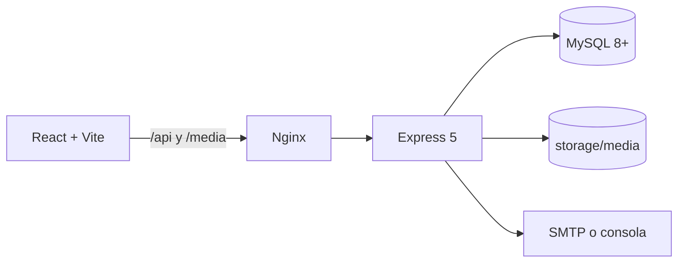
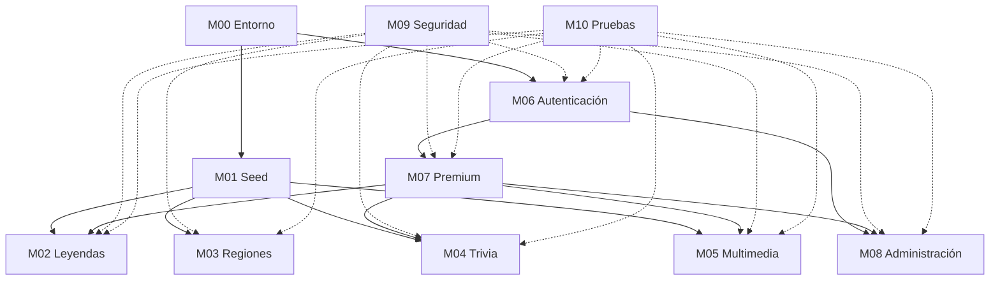

# Roadmap Backend - Ecos de Nicaragua

> Plan técnico de ejecución para completar el backend del MVP y dejarlo listo para el frontend.
> No reemplaza a `ROADMAP.md`; lo desglosa en módulos independientes para trabajo paralelo con OpenCode.
> Todo texto visible, recursos y mensajes de error van en español.

## Objetivo General

Entregar una API REST en Node.js + Express 5 respaldada por MySQL 8+ que sirva todo el contenido del MVP, gestione usuarios con sesiones seguras, aplique el reparto gratis/premium en el servidor y permita administrar usuarios, suscripciones y códigos de activación.

Al terminar este plan deben existir:

- 6 leyendas con ficha, versiones, fuentes, regiones, imágenes y audios.
- 17 regiones con sus leyendas asociadas y nivel de verificación.
- Trivia de 5 preguntas por leyenda, con validación y puntaje en el servidor.
- Multimedia servida desde almacenamiento estático, con autorización para el contenido premium.
- Registro, login, logout, sesiones con cookies, CSRF, recuperación de contraseña y roles.
- Planes, suscripciones, activación manual y códigos de un solo uso.
- API de administración con registro de auditoría.
- Validación, rate limiting, cabeceras de seguridad, logs y pruebas automatizadas.

**Criterio de éxito:** un desarrollador nuevo clona el repositorio, ejecuta `npm install`, `npm run setup` y `npm run dev`, y en menos de 10 minutos tiene la API y la base de datos funcionando con datos reales. El frontend puede construir todas sus pantallas contra esta API sin mocks.

**Fuera de alcance:** pasarela de pago, app móvil, aula virtual, panel institucional, mapa de los 153 municipios, panel de edición de contenido cultural, progreso por usuario y material educativo. Tampoco se implementa frontend.

# Arquitectura General

## Vista de componentes



En desarrollo, Vite redirige `/api` a `http://localhost:3000`; no se necesita CORS. En producción, Nginx sirve el frontend y hace proxy de `/api` al proceso Node administrado por PM2. El almacenamiento multimedia nunca se expone directamente: el API valida la sesión y el premium antes de transmitir archivos.

## Capas del backend

| Capa | Responsabilidad | Ubicación |
|---|---|---|
| Rutas | Declarar método, ruta, middlewares y controlador | `server/src/routes/` |
| Middlewares | CSRF, autenticación, premium, validación, rate limit, errores | `server/src/middleware/` |
| Controladores | Leer `req` validado, llamar al servicio y responder | `server/src/controllers/` |
| Servicios | Reglas de negocio, consultas SQL y transacciones | `server/src/services/` |
| Esquemas | Validación de entrada con Zod | `server/src/schemas/` |
| Utilidades | Errores, respuestas, hashes, tokens, medios, logger | `server/src/utils/` |
| Acceso a datos | Pool MySQL y helper de transacciones | `server/src/db.js` |

No se usa ORM. Las consultas son SQL parametrizado con `mysql2/promise`. Los controladores no contienen SQL; los servicios no escriben en `res`.

## Base de datos

- MySQL 8.0 o superior, InnoDB, `utf8mb4`, `utf8mb4_unicode_ci`.
- El esquema base ya existe en `server/db/migrations/001_esquema-inicial.sql` (16 tablas).
- Las migraciones son archivos SQL ordenados y se registran en `schema_migrations`. Una migración aplicada no se edita.
- Extensiones previstas, cada una en una migración nueva:
  - `002`: `leyendas.alcance`, `fuentes.clave`, `imagenes.es_premium` y sus índices.
  - `003`: tabla `sesiones` y columna `usuarios.sesion_version`.
  - `004`: tabla `auditoria_admin`.
- El seed es idempotente y versionado en `server/db/seed/`. La base guarda rutas de archivos, nunca los archivos.
- Las fechas de suscripción se comparan con `CURDATE()`; los permisos se leen en cada petición, no se guardan en la sesión.

## API REST

- Prefijo `/api`. No se versiona en el MVP; un cambio incompatible futuro usa `/api/v2`.
- Respuesta correcta: `{ "data": ..., "meta": ... }`. `meta` es opcional.
- Respuesta de error: `{ "error": { "codigo": "...", "mensaje": "...", "detalles": [...] } }`.
- `Content-Type: application/json; charset=utf-8`.
- Fechas de calendario: `YYYY-MM-DD`. Marcas de tiempo: ISO 8601 UTC.
- Identificadores públicos: `slug` para leyendas y `codigo` para regiones. La administración usa `id` numérico.
- Paginación: `page` desde 1, `limit` entre 1 y 50, por defecto 20.
- Errores esperados: 400 validación, 401 sin sesión, 403 sin permiso, 404 no encontrado, 409 conflicto, 429 límite, 500 error interno.

## Multimedia

- Archivos en `server/storage/media/`, fuera de MySQL y fuera del repositorio.
- `imagenes.ruta` y `audios.ruta` guardan solo la ruta relativa interna.
- `npm run media:import` copia y optimiza los archivos de `img/` y `audios/` a `storage/media/`; las imágenes se convierten a WebP.
- El API transmite imágenes y audios desde `/api/media/...`, con autorización, caché y soporte de `Range` para audio.
- No hay subida de archivos en el MVP.

## Autenticación

- Sesiones de servidor con `express-session` y almacén MySQL. Cookie `HttpOnly`, `Secure` en producción, `SameSite=Lax`, expiración y rotación al iniciar sesión.
- CSRF con token de sesión y cabecera `X-CSRF-Token` en métodos `POST`, `PUT`, `PATCH` y `DELETE`.
- Contraseñas con Argon2id. Nunca texto plano, SHA directo ni JWT.
- La sesión guarda solo `usuarioId`, `csrfToken` y `sesionVersion`; el rol y el premium se consultan en cada petición.
- `POST /api/auth/refresh` renueva la expiración de la sesión; no emite tokens JWT.

## Premium

- El acceso se determina por una fila de `suscripciones` con `estado='activa'`, `fecha_inicio <= CURDATE()` y `fecha_fin >= CURDATE()`.
- `usuarios.rol` y `usuarios.estado_suscripcion` no autorizan contenido premium.
- El middleware `resolverAccesoPremium` deja en `req.acceso` el resultado para que los servicios filtren versiones, imágenes, audios y preguntas.
- La activación es manual desde administración o por código de un solo uso. No hay pasarela de pago.

## Administración

- API bajo `/api/admin`, solo para `rol='admin'`.
- Permite buscar usuarios, cambiar roles, activar o quitar premium, fijar vencimientos, generar códigos y consultar el registro de auditoría.
- No permite editar leyendas, regiones, imágenes ni audios; el contenido se carga por seed.
- Cada mutación administrativa escribe una fila en `auditoria_admin` sin secretos.

## Relación entre módulos



## Flujo de una petición

1. `requestId` y logger asignan identificador y registran método, ruta y duración.
2. Helmet, CORS opcional, límite de cuerpo JSON y sesión.
3. CSRF en métodos mutantes.
4. Rate limit por IP y ruta.
5. `resolverAccesoPremium` carga usuario y suscripción vigente.
6. Validación Zod de `params`, `query` y `body`.
7. Controlador, servicio y consulta parametrizada.
8. Respuesta `{data}` o error normalizado.
9. Log final sin cuerpos, cookies, tokens ni contraseñas.

## Supuestos técnicos que no bloquean

- El plan premium inicial dura 30 días y se puede ajustar en `planes.json`; el precio no se modela.
- En desarrollo el correo de recuperación se imprime en consola; en producción se usa SMTP.
- El rate limiting en memoria es suficiente para una instancia. Si se usan varias, se cambia el almacén.
- `fichas-regiones.md` aporta notas y fuentes para `leyenda_regiones.nota`; no se crea una tabla de municipios ni de lugares.

# Módulo 00 - Entorno de Desarrollo

## Objetivo

Dejar el proyecto instalable y ejecutable con el mínimo de pasos manuales. El único trabajo previo del colaborador es instalar Node.js y MySQL. La base de datos, el archivo `.env`, las migraciones, el seed y los archivos multimedia se crean con comandos del proyecto.

## Software requerido

| Software | Versión recomendada | Mínimo | Comprobación |
|---|---|---|---|
| Node.js | 22 LTS | 20.19 | `node -v` |
| npm | 10 | 10 | `npm -v` |
| MySQL Server | 8.4 LTS | 8.0 | `mysql --version` |
| Git | Última estable | 2.30 | `git --version` |
| Editor | VS Code u OpenCode | — | — |

No se requiere Docker, XAMPP, PHP, Redis ni instalar paquetes globales. MySQL debe estar iniciado antes de ejecutar `npm run setup`. En Windows, el servicio puede llamarse `MySQL84` o similar; en Linux, `sudo systemctl start mysql`.

## Estructura de trabajo

El repositorio usa **npm workspaces** para que `npm install` en la raíz instale cliente y servidor.

```text
ecos-nicaragua/
├─ package.json              # workspaces y scripts raíz
├─ .nvmrc                    # 22
├─ .env.example
├─ .env                      # generado por setup, ignorado por git
├─ client/
└─ server/
```

- Al migrar a workspaces, eliminar `client/package-lock.json` y `server/package-lock.json` y generar un único `package-lock.json` en la raíz. No mezclar instalaciones parciales.

## Variables de entorno

Archivo único en la raíz: `.env`. `server/src/config.js` lo carga desde `../../.env`. En producción se puede usar el mismo archivo con permisos `600` o variables del sistema.

| Variable | Ejemplo | Obligatoria | Secreta | Uso |
|---|---|---|---|---|
| `NODE_ENV` | `development` | Sí | No | `development`, `test`, `production` |
| `PORT` | `3000` | No | No | Puerto del API |
| `APP_URL` | `http://localhost:5173` | Sí | No | Enlaces de recuperación |
| `CLIENT_ORIGIN` | `http://localhost:5173` | No | No | Origen permitido si CORS está activo |
| `CORS_ENABLED` | `false` | No | No | `true` solo si frontend y API tienen orígenes distintos |
| `TRUST_PROXY` | `0` | No | No | `1` detrás de Nginx |
| `DB_HOST` | `127.0.0.1` | Sí | No | Host MySQL |
| `DB_PORT` | `3306` | Sí | No | Puerto MySQL |
| `DB_USER` | `root` | Sí | No | Usuario MySQL de desarrollo |
| `DB_PASSWORD` | vacío | No | Sí | Contraseña MySQL |
| `DB_NAME` | `ecos_nicaragua_dev` | Sí | No | Base de desarrollo |
| `SESSION_SECRET` | generado | Sí | Sí | Firma de cookies de sesión |
| `SESSION_NAME` | `ecos.sid` | No | No | Nombre de cookie |
| `SESSION_TTL_HORAS` | `8` | No | No | Duración de sesión |
| `COOKIE_SECURE` | `false` | No | No | `true` en producción |
| `TOKEN_PEPPER` | generado | Sí | Sí | HMAC de códigos y tokens de recuperación |
| `RESET_TOKEN_MINUTOS` | `60` | No | No | Vigencia de recuperación |
| `MEDIA_ROOT` | `./storage/media` | No | No | Carpeta de archivos |
| `MEDIA_URL` | `/media` | No | No | Prefijo interno |
| `MAIL_TRANSPORT` | `console` | No | No | `console`, `memory` o `smtp` |
| `SMTP_HOST` | vacío | No | No | Servidor SMTP |
| `SMTP_PORT` | `587` | No | No | Puerto SMTP |
| `SMTP_USER` | vacío | No | Sí | Usuario SMTP |
| `SMTP_PASSWORD` | vacío | No | Sí | Contraseña SMTP |
| `MAIL_FROM` | `Ecos de Nicaragua <no-reply@ejemplo.com>` | No | No | Remitente |
| `LOG_LEVEL` | `info` | No | No | Nivel de logs |
| `RATE_LIMIT_ENABLED` | `true` | No | No | `false` solo en pruebas |

Reglas:

- `SESSION_SECRET` y `TOKEN_PEPPER` se generan con `crypto.randomBytes(48).toString('hex')` si están vacíos.
- Los valores con `#` se escriben entre comillas en `.env`.
- `.env` está en `.gitignore`. El repositorio solo versiona `.env.example`.
- En producción, `COOKIE_SECURE=true`, `TRUST_PROXY=1` y `NODE_ENV=production` son obligatorios.
- `config.js` falla al arrancar en producción si falta un secreto o si `SESSION_SECRET` tiene menos de 32 caracteres.

## Scripts npm requeridos

### Raíz

```json
{
  "name": "ecos-nicaragua",
  "private": true,
  "workspaces": ["client", "server"],
  "engines": { "node": ">=20.19" },
  "scripts": {
    "setup": "npm run setup -w server",
    "dev": "concurrently -n api,web -c cyan,magenta \"npm:dev:api\" \"npm:dev:client\"",
    "dev:api": "npm run dev -w server",
    "dev:client": "npm run dev -w client",
    "db:migrate": "npm run db:migrate -w server",
    "db:seed": "npm run db:seed -w server",
    "db:seed:validate": "npm run db:seed:validate -w server",
    "reset-db": "npm run reset-db -w server",
    "media:import": "npm run media:import -w server",
    "admin:create": "npm run admin:create -w server",
    "test": "npm test -w server",
    "test:unit": "npm run test:unit -w server",
    "test:integration": "npm run test:integration -w server"
  },
  "devDependencies": {
    "concurrently": "^9.2.0"
  }
}
```

### Servidor

```json
{
  "scripts": {
    "dev": "node --watch src/index.js",
    "start": "node src/index.js",
    "setup": "node scripts/setup.js",
    "db:migrate": "node scripts/migrate.js",
    "db:seed": "node scripts/seed.js",
    "db:seed:validate": "node scripts/validate-seed.js",
    "db:setup": "npm run db:migrate && npm run db:seed",
    "reset-db": "node scripts/reset-db.js",
    "media:import": "node scripts/media-import.js",
    "admin:create": "node scripts/create-admin.js",
    "test": "npm run test:db:setup && cross-env NODE_ENV=test DB_NAME=ecos_nicaragua_test MAIL_TRANSPORT=memory RATE_LIMIT_ENABLED=false node --test --test-concurrency=1 tests",
    "test:db:setup": "cross-env NODE_ENV=test DB_NAME=ecos_nicaragua_test npm run db:setup",
    "test:unit": "cross-env NODE_ENV=test node --test --test-concurrency=1 tests/unit",
    "test:integration": "npm run test:db:setup && cross-env NODE_ENV=test DB_NAME=ecos_nicaragua_test MAIL_TRANSPORT=memory RATE_LIMIT_ENABLED=false node --test --test-concurrency=1 tests/integration tests/api"
  }
}
```

Dependencias del servidor:

| Paquete | Uso |
|---|---|
| `express` 5 | API |
| `mysql2` | Pool y consultas preparadas |
| `dotenv` | Carga de `.env` |
| `zod` | Validación |
| `express-session` + `express-mysql-session` | Sesiones en MySQL |
| `argon2` | Hash de contraseñas |
| `helmet` | Cabeceras de seguridad |
| `express-rate-limit` | Límite de peticiones |
| `pino` + `pino-http` | Logs |
| `nodemailer` | Correo de recuperación |
| `sharp` | Conversión de imágenes a WebP |
| `cors` | Solo si `CORS_ENABLED=true` |

Desarrollo: `cross-env`, `supertest`, `pino-pretty`.

## Cómo crear la base automáticamente

`scripts/migrate.js` ya crea la base si no existe. `setup.js` reutiliza esa función. La secuencia exacta es:

```sql
CREATE DATABASE IF NOT EXISTS `ecos_nicaragua_dev`
  CHARACTER SET utf8mb4
  COLLATE utf8mb4_unicode_ci;
```

Implementación:

1. Conectar a MySQL **sin** seleccionar base, usando `DB_HOST`, `DB_PORT`, `DB_USER` y `DB_PASSWORD`.
2. Ejecutar `CREATE DATABASE IF NOT EXISTS ?? CHARACTER SET utf8mb4 COLLATE utf8mb4_unicode_ci` con el identificador escapado por `mysql2` (`??`).
3. Reconectar con `database: DB_NAME`.
4. Aplicar migraciones y seed.
5. Si el usuario no tiene permiso `CREATE`, mostrar el error y el comando `GRANT` necesario. No crear usuarios MySQL automáticamente.

`npm run setup` ejecuta:

```text
1. Comprobar Node.js y conexión a MySQL.
2. Crear .env desde .env.example si no existe.
3. Generar SESSION_SECRET y TOKEN_PEPPER si están vacíos.
4. Probar credenciales. Si fallan y hay terminal interactiva, preguntar host, puerto, usuario y contraseña, y reescribir .env.
5. Crear la base si no existe.
6. Ejecutar migraciones.
7. Validar y cargar el seed.
8. Importar y optimizar multimedia.
9. Imprimir URL del API, URL del cliente y siguiente comando.
```

Opciones:

- `npm run setup -- --yes`: no pregunta; falla si no puede conectar.
- `npm run setup -- --skip-media`: no importa multimedia.
- `npm run reset-db`: elimina y recrea la base actual, luego migra, carga seed e importa multimedia.
- `npm run reset-db -- --force`: permite borrar una base cuyo nombre no termina en `_dev` o `_test`. Nunca se permite con `NODE_ENV=production`.

## Checklist de instalación

- [x] `node -v` devuelve 20.19 o superior.
- [ ] `npm -v` devuelve 10 o superior.
- [ ] MySQL está iniciado y responde en `DB_HOST:DB_PORT`.
- [ ] El repositorio está clonado y se ejecutó `npm install` en la raíz.
- [ ] `npm run setup` termina sin errores.
- [ ] `.env` existe en la raíz y no está versionado.
- [x] `npm run db:seed:validate` termina con `Seed válido`.
- [ ] `npm run dev:api` inicia en `http://localhost:3000`.
- [x] `GET /api/health` devuelve `status: ok` y `db: ok`.
- [ ] `npm run dev` levanta API y cliente.
- [ ] Una segunda ejecución de `npm run setup` no duplica datos.

## Tareas obligatorias

| ID | Tarea | Archivos | Depende de |
|---|---|---|---|
| M00-T01 | Crear `package.json` raíz con workspaces y scripts | `package.json`, `.nvmrc` | — |
| M00-T02 | Actualizar `.env.example`, `.gitignore` y README | `.env.example`, `.gitignore`, `README.md` | — |
| M00-T03 | Implementar `config.js`, `db.js`, logger y errores | `server/src/config.js`, `db.js`, `utils/` | M00-T01 |
| M00-T04 | Crear `app.js`, `index.js` y orden de middlewares | `server/src/app.js`, `index.js` | M00-T03 |
| M00-T05 | Crear todos los routers y montarlos una sola vez | `server/src/routes/` | M00-T04 |
| M00-T06 | Implementar `setup.js`, `migrate.js`, `seed.js`, `reset-db.js`, `media-import.js` | `server/scripts/` | M00-T03 |
| M00-T07 | Implementar health con comprobación de base | `server/src/routes/health.routes.js` | M00-T04 |
| M00-T08 | Documentar instalación y solución de problemas | `README.md` | M00-T06 |
| M00-T09 | Probar en una máquina limpia y ajustar mensajes | — | M00-T01 a M00-T08 |

## Archivos y carpetas creados en este módulo

```text
server/src/
├─ app.js
├─ index.js
├─ config.js
├─ db.js
├─ routes/
│  ├─ index.js
│  ├─ health.routes.js
│  ├─ leyendas.routes.js
│  ├─ categorias.routes.js
│  ├─ regiones.routes.js
│  ├─ trivia.routes.js
│  ├─ media.routes.js
│  ├─ auth.routes.js
│  ├─ premium.routes.js
│  └─ admin.routes.js
├─ middleware/
│  ├─ error.js
│  ├─ notFound.js
│  ├─ requestId.js
│  └─ validate.js
└─ utils/
   ├─ errors.js
   ├─ http.js
   └─ logger.js
server/scripts/
├─ setup.js
├─ migrate.js
├─ seed.js
├─ validate-seed.js
├─ reset-db.js
├─ media-import.js
└─ create-admin.js
```

Los routers se crean vacíos y responden `501 NO_IMPLEMENTADO` con el formato de error común. Así cada desarrollador reemplaza solo su archivo y nadie edita `routes/index.js` durante el trabajo paralelo.

## Contrato de `GET /api/health`

- Auth: no.
- Éxito: `200`.
- Error de base: `503`.
- Respuesta: `{ "status": "ok", "db": "ok", "version": "0.2.0" }`.
- Si la base falla: `{ "status": "error", "db": "error" }` y no se expone el error SQL.

## Solución de problemas

| Síntoma | Causa probable | Acción |
|---|---|---|
| `ECONNREFUSED` | MySQL apagado o puerto incorrecto | Iniciar servicio o ajustar `DB_PORT` |
| `ER_ACCESS_DENIED_ERROR` | Usuario o contraseña incorrectos | Ejecutar setup y corregir credenciales |
| `ER_DBACCESS_DENIED_ERROR` | Usuario sin permiso sobre la base | Conceder permisos o usar un usuario con `CREATE` |
| `EADDRINUSE` | Puerto 3000 ocupado | Cambiar `PORT` |
| `Cannot find module 'sharp'` | Dependencias incompletas | `npm install` en la raíz |
| `SESSION_SECRET` vacío | `.env` incompleto | `npm run setup` |
| Migración aplicada a medias | Error SQL | Corregir y crear migración nueva; no editar la anterior |

## Resultado esperado

Un colaborador con Node.js y MySQL instalados debe poder ejecutar:

```bash
git clone <repo>
cd ecos-nicaragua
npm install
npm run setup
npm run dev
```

y abrir `http://localhost:3000/api/health` y `http://localhost:5173` sin crear bases, usuarios MySQL ni tablas a mano. Tiempo objetivo: menos de 10 minutos con MySQL ya iniciado.

## Definition of Done

- `npm install` en la raíz instala cliente y servidor.
- `npm run setup` funciona desde cero y también si se repite.
- `npm run reset-db` recrea la base y deja datos de seed.
- `db:migrate` es idempotente y crea la base si no existe.
- `db:seed` valida antes de escribir y es idempotente.
- `.env` se genera con secretos aleatorios y nunca se versiona.
- `GET /api/health` comprueba la base.
- Los routers vacíos responden `501` con el formato de error común.
- README explica instalación, comandos y errores frecuentes.
- Una persona distinta al autor completa el checklist en una máquina limpia.

# Módulo 01 - Seed y Datos Iniciales

## Objetivo

Cargar en MySQL todo el contenido del MVP desde archivos JSON versionados, de forma validada, transaccional e idempotente. El seed no inventa contenido: toma los datos de `docs/canon-leyendas.md`, `docs/fichas-regiones.md`, `docs/trivia.md`, `docs/guiones-narracion.md` y las investigaciones.

## Alcance

- 17 regiones (ya existen).
- 4 categorías.
- 6 leyendas canónicas con versiones, regiones, fuentes, imágenes y audios.
- 30 preguntas de trivia (5 por leyenda), 4 opciones cada una y 1 correcta.
- Al menos 1 plan premium activo.
- No se cargan usuarios, suscripciones, códigos ni datos de progreso.

## Archivos involucrados

```text
server/db/
├─ migrations/
│  └─ 002_alcance_fuentes_imagenes.sql
└─ seed/
   ├─ regiones.json        # ya existe
   ├─ categorias.json
   ├─ fuentes.json
   ├─ leyendas.json        # contenido anidado
   └─ planes.json
server/scripts/
├─ seed.js                 # reescritura
├─ validate-seed.js
└─ media-import.js
server/tests/unit/seed.test.js
```

## Migración 002

```sql
ALTER TABLE leyendas
  ADD COLUMN alcance ENUM('nacional', 'regional', 'local')
    NOT NULL DEFAULT 'regional' AFTER origen,
  ADD KEY idx_leyendas_alcance (alcance);

ALTER TABLE fuentes
  ADD COLUMN clave VARCHAR(80) NULL AFTER id,
  ADD UNIQUE KEY uq_fuentes_clave (clave);

ALTER TABLE imagenes
  ADD COLUMN es_premium BOOLEAN NOT NULL DEFAULT FALSE AFTER es_principal,
  ADD KEY idx_imagenes_principal (leyenda_id, es_principal);
```

Justificación:

- `alcance` permite representar leyendas nacionales o regionales sin inventar vínculos con departamentos. El canon dice que El Cadejo y La Carreta Nagua no pertenecen a un único departamento.
- `fuentes.clave` permite que el seed referencie fuentes sin IDs numéricos y sea idempotente.
- `imagenes.es_premium` permite que la imagen principal sea gratuita y las adicionales premium, sin exponer rutas directas.

No se agrega tabla de municipios, lugares, materiales educativos, respuestas por usuario ni progreso.

## JSON requeridos

### `regiones.json` (existente)

```json
[
  { "codigo": "matagalpa", "nombre": "Matagalpa", "tipo": "departamento" },
  { "codigo": "esteli", "nombre": "Estelí", "tipo": "departamento" }
]
```

Debe contener exactamente las 17 unidades: 15 departamentos y 2 regiones autónomas.

### `categorias.json`

```json
[
  { "slug": "tradicion-oral", "nombre": "Tradición oral" },
  { "slug": "sobrenatural", "nombre": "Sobrenatural" },
  { "slug": "apariciones", "nombre": "Apariciones" },
  { "slug": "historica-religiosa", "nombre": "Histórica y religiosa" }
]
```

### `fuentes.json`

```json
[
  {
    "clave": "palma-mujeres-del-mito",
    "titulo": "Mujeres del mito",
    "autor": "Milagros Palma",
    "tipo": "libro",
    "referencia": "Edición consultada",
    "url": null,
    "licencia": null
  }
]
```

Campos obligatorios: `clave`, `titulo`, `tipo`. `tipo` debe ser `libro`, `articulo`, `sitio_web`, `testimonio_oral` u `otro`. `clave` es única, en minúsculas, números y guiones. Las fuentes reales se toman de las investigaciones; no se inventan.

### `leyendas.json`

Estructura anidada para que un solo archivo contenga todo el contenido de cada leyenda:

```json
[
  {
    "slug": "la-mocuana",
    "titulo": "La Mocuana",
    "categoria": "tradicion-oral",
    "resumen": "Resumen breve en texto plano.",
    "historia": "Texto completo en Markdown.",
    "origen": "Texto de origen o null.",
    "alcance": "local",
    "regiones": [
      {
        "codigo": "matagalpa",
        "fuente": "palma-mujeres-del-mito",
        "nivelVerificacion": "verificado",
        "nota": "Sébaco"
      }
    ],
    "versiones": [
      {
        "titulo": "Versión canónica",
        "contenido": "Texto en Markdown.",
        "esPremium": false,
        "orden": 1,
        "fuente": "palma-mujeres-del-mito"
      }
    ],
    "imagenes": [
      {
        "archivo": "img/mocuana/portada.jpg",
        "ruta": "leyendas/la-mocuana/portada.webp",
        "textoAlternativo": "La Mocuana junto a una cueva.",
        "licencia": "PENDIENTE",
        "esPrincipal": true,
        "esPremium": false
      }
    ],
    "audios": [
      {
        "archivo": "audios/la mocuana.mp3",
        "ruta": "audios/la-mocuana.mp3",
        "titulo": "La Mocuana: La mujer de la cueva",
        "duracionSegundos": null,
        "licencia": "PENDIENTE",
        "esPremium": true
      }
    ],
    "preguntas": [
      {
        "orden": 1,
        "enunciado": "¿Cómo se llama la protagonista?",
        "explicacion": "La respuesta correcta es La Mocuana.",
        "esPremium": false,
        "opciones": [
          { "orden": 1, "texto": "La Cegua", "esCorrecta": false },
          { "orden": 2, "texto": "La Mocuana", "esCorrecta": true },
          { "orden": 3, "texto": "La Llorona", "esCorrecta": false },
          { "orden": 4, "texto": "La Tulivieja", "esCorrecta": false }
        ]
      }
    ]
  }
]
```

Campos obligatorios por leyenda: `slug`, `titulo`, `categoria`, `resumen`, `historia`, `alcance`, `regiones` (puede ser `[]`), `versiones` (mínimo 1), `imagenes` (mínimo 1), `audios` (mínimo 1), `preguntas` (exactamente 5). `origen` puede ser `null`.

Reglas de contenido:

- `slug`: `^[a-z0-9-]+$`, único.
- `alcance`: `nacional`, `regional` o `local`.
- Cada vínculo `regiones[]` exige `codigo` existente, `fuente` existente y `nivelVerificacion` en `verificado`, `testimonio_oral`, `pendiente`, `sin_verificar`.
- Una leyenda con `alcance` `nacional` o `regional` puede tener `regiones: []`; no se le asignan departamentos sin respaldo.
- `versiones[]`: al menos una con `esPremium: false`; `orden` único.
- `imagenes[]`: exactamente una con `esPrincipal: true`; `ruta` única; `archivo` debe existir; `licencia` no vacía.
- `audios[]`: `ruta` única; `archivo` debe existir; `licencia` no vacía.
- `preguntas[]`: exactamente 5; `orden` 1 a 5; exactamente 4 opciones; exactamente 1 `esCorrecta`; `esPremium` debe ser `false` para órdenes 1 y 2, y `true` para 3, 4 y 5.
- Si una licencia aún no está documentada, se usa `PENDIENTE` y el seed emite una advertencia. No se inventa una licencia.

### `planes.json`

```json
[
  { "nombre": "Premium 30 días", "duracionDias": 30, "activo": true }
]
```

El precio y la duración definitiva son una decisión abierta de `ROADMAP.md`. El valor de 30 días es el inicial para desbloquear el desarrollo y se cambia en este archivo cuando el autor lo confirme.

## Mapa de datos canónicos

| Leyenda | `slug` | `alcance` | Regiones vinculadas |
|---|---|---|---|
| La Mocuana | `la-mocuana` | `local` | Matagalpa (Sébaco), Estelí (La Trinidad) |
| El Cadejo | `el-cadejo` | `nacional` | — |
| La Carreta Nagua | `la-carreta-nagua` | `nacional` | — |
| La Cegua | `la-cegua` | `regional` | — |
| La Llorona | `la-llorona` | `local` | Rivas (Ometepe), León |
| El Padre sin Cabeza | `el-padre-sin-cabeza` | `local` | León (León Viejo y ciudad de León) |

`fichas-regiones.md` se usa para completar `nota` (por ejemplo, «Sébaco» o «La Trinidad») y para elegir fuentes. No se crea una tabla de lugares.

## Reparto gratis/premium en el seed

| Recurso | Gratis | Premium |
|---|---|---|
| Versiones | `esPremium: false` | Todas |
| Imágenes | `esPrincipal: true` | Todas |
| Audios | Ninguno | Todos |
| Preguntas | Órdenes 1 y 2 | Órdenes 1 a 5 |

## Tareas

| ID | Tarea | Archivos | Depende de |
|---|---|---|---|
| M01-T01 | Crear migración 002 y probarla desde base vacía | `002_alcance_fuentes_imagenes.sql` | M00 |
| M01-T02 | Crear `categorias.json` y `fuentes.json` con datos reales | `server/db/seed/` | M01-T01 |
| M01-T03 | Crear `leyendas.json` con las 6 leyendas y 5 preguntas cada una | `server/db/seed/` | M01-T02 |
| M01-T04 | Crear `planes.json` | `server/db/seed/` | M01-T01 |
| M01-T05 | Implementar validación previa al seed | `scripts/validate-seed.js` | M01-T02 |
| M01-T06 | Reescribir seed con transacción y upsert por claves naturales | `scripts/seed.js` | M01-T05 |
| M01-T07 | Probar doble ejecución y conteos | `tests/unit/seed.test.js` | M01-T06 |
| M01-T08 | Documentar cómo actualizar contenido | `README.md` | M01-T06 |

## Algoritmo del seed

1. Leer los cinco JSON y validarlos.
2. Abrir una transacción.
3. Upsert de regiones por `codigo` (no borrar las 17).
4. Upsert de categorías por `slug`.
5. Upsert de fuentes por `clave`.
6. Para cada leyenda:
   - Upsert en `leyendas` por `slug`.
   - Borrar solo sus hijos: `leyenda_regiones`, `leyenda_versiones`, `imagenes`, `audios` y `preguntas` (las opciones caen por `ON DELETE CASCADE`).
   - Insertar regiones, versiones, imágenes, audios y preguntas con sus opciones.
7. Upsert de planes por `nombre`.
8. Commit y resumen de conteos.
9. Si algo falla, rollback completo y código de salida 1.

El seed no toca `usuarios`, `suscripciones`, `codigos_activacion`, `recuperacion_password` ni `auditoria_admin`. Se puede ejecutar muchas veces sin duplicar filas.

## Validaciones obligatorias antes de escribir

- 17 regiones, códigos únicos.
- 4 categorías, slugs únicos.
- Fuentes con `clave` única y campos mínimos.
- 6 leyendas con los slugs canónicos, sin duplicados.
- Al menos 2 fuentes referenciadas por leyenda.
- Cada vínculo regional apunta a región y fuente existentes.
- Al menos una versión gratuita por leyenda.
- Exactamente una imagen principal por leyenda.
- Archivos de imagen y audio existentes en las rutas `archivo`.
- 5 preguntas por leyenda, 4 opciones, 1 correcta, órdenes únicos.
- Al menos un plan activo.
- No hay rutas de archivo repetidas.

## Entregables

- Migración 002 aplicada y registrada.
- JSON de seed completos y versionados.
- `npm run db:seed:validate` con salida `Seed válido`.
- `npm run db:seed` transaccional e idempotente.
- Conteos verificables: 17 regiones, 4 categorías, 6 leyendas, 6+ fuentes, 6+ versiones, 6+ imágenes, 6 audios, 30 preguntas, 120 opciones, 1+ plan.
- Pruebas unitarias de validación del seed.

## Definition of Done

- `npm run db:migrate` desde una base vacía crea todas las tablas y aplica 001 y 002.
- `npm run db:seed` dos veces seguidas deja los mismos conteos.
- Una fuente, región o categoría inexistente hace fallar el seed con mensaje claro.
- Una pregunta con dos respuestas correctas hace fallar la validación.
- Un archivo de imagen o audio faltante hace fallar la validación antes de escribir.
- El seed no modifica usuarios ni suscripciones.
- Los conteos coinciden con el contenido del MVP.
- El contenido proviene de los documentos del proyecto; no hay texto cultural inventado por el backend.

# Módulo 02 - API de Leyendas

## Objetivo

Servir la biblioteca de leyendas, su ficha completa y las opciones de filtro, respetando el reparto gratis/premium en el servidor.

## Rutas

| Método | Ruta | Auth | Premium | Descripción |
|---|---|---|---|---|
| GET | `/api/leyendas` | Opcional | Opcional | Lista paginada con filtros |
| GET | `/api/leyendas/:slug` | Opcional | Opcional | Ficha completa |
| GET | `/api/categorias` | No | No | Categorías para filtros |

## Controladores

`server/src/controllers/leyendas.controller.js`:

- `listarLeyendas(req, res)`: usa `req.query` validado y `req.acceso.premium`.
- `obtenerLeyenda(req, res)`: usa `req.params.slug` y `req.acceso.premium`.
- `listarCategorias(req, res)`.

Los controladores son delgados: no arman SQL ni transforman filas complejas.

## Servicios

`server/src/services/leyendas.service.js`:

- `listar({ region, categoria, q, alcance, page, limit, orden, premium })`.
- `obtenerPorSlug(slug, premium)`.
- `serializarResumen(fila, premium)`.
- `serializarDetalle(fila, premium)`.

`server/src/services/categorias.service.js`:

- `listar()` con conteo de leyendas.

Consultas:

- Lista: una consulta paginada con `EXISTS` para región y categoría, más una consulta de conteo. No usar `GROUP_CONCAT` para estructuras complejas.
- Detalle: consultas separadas para leyenda+categoría, regiones+fuentes, versiones, imágenes, audios y fuentes deduplicadas. Para 1 leyenda es aceptable y evita duplicar filas.
- Búsqueda `q`: `LIKE ? ESCAPE '\\'` sobre `titulo` y `resumen`; escapar `%`, `_` y `\`.
- Orden permitido: `titulo` (por defecto) y `reciente` (`creada_en DESC`). Cualquier otro valor es 400.
- `LIMIT ? OFFSET ?` con enteros validados.

## Validaciones

| Entrada | Regla |
|---|---|
| `region` | string, código existente o vacío; si no existe, lista vacía |
| `categoria` | string, slug; si no existe, lista vacía |
| `q` | string 2-60, recortada |
| `alcance` | `nacional`, `regional` o `local` |
| `page` | entero >= 1, por defecto 1 |
| `limit` | entero 1-50, por defecto 20 |
| `orden` | `titulo` o `reciente` |
| `slug` | `^[a-z0-9-]{1,100}$`; si no existe, 404 |

## Reglas de respuesta

- La lista siempre incluye las 6 leyendas, aunque el usuario sea gratis.
- Free: `imagenes` solo la principal; `versiones` solo `es_premium=0`; `audios` vacío; `preguntas` no se incluyen.
- Premium: todas las versiones, todas las imágenes y metadatos de audios.
- `historia` y `origen` son públicos; el premium está en versiones ampliadas, imágenes adicionales, audios y preguntas.
- `contenidoBloqueado` informa cuántos elementos premium existen sin revelar rutas ni IDs de audio.
- Las fuentes y el nivel de verificación son públicos en la ficha para no ocultar la procedencia.
- `formatoContenido: "markdown"` indica que `historia`, `origen` y `contenido` pueden contener Markdown; el frontend debe renderizarlo con sanitización.
- Si una leyenda no tiene imagen principal, `imagenPrincipal` es `null`.

## Entregables

- Rutas, controlador, servicio y esquemas.
- Serialización free/premium probada.
- Filtros por región, categoría, texto y alcance.
- Paginación y orden.
- 404 para slug inexistente.
- Pruebas de integración.

## Definition of Done

- `GET /api/leyendas` devuelve 200 con `data` y `meta`.
- `GET /api/leyendas?region=matagalpa` devuelve solo las leyendas vinculadas.
- `GET /api/leyendas?q=mocuana` encuentra la leyenda sin distinguir mayúsculas.
- `GET /api/leyendas/la-mocuana` devuelve ficha completa y fuentes.
- Un usuario gratis recibe solo la imagen principal y las versiones gratuitas.
- Un usuario premium recibe todas las versiones e imágenes y los metadatos de audio.
- Ningún endpoint devuelve `ruta` interna de archivos ni `password_hash`.
- `GET /api/categorias` devuelve las 4 categorías con su conteo.
- Las pruebas cubren free, premium, filtros, paginación y 404.

# Módulo 03 - API de Regiones

## Objetivo

Entregar los datos de las 17 unidades territoriales para el mapa SVG y las fichas regionales, con sus leyendas asociadas, fuente y nivel de verificación.

## Rutas

| Método | Ruta | Auth | Premium | Descripción |
|---|---|---|---|---|
| GET | `/api/regiones` | Opcional | Opcional | Lista completa de las 17 unidades |
| GET | `/api/regiones/:codigo` | Opcional | Opcional | Detalle de una región |

No se agrega un endpoint `/api/mapa`: el frontend usa `GET /api/regiones` y dibuja su SVG propio.

## Controladores

`server/src/controllers/regiones.controller.js`:

- `listarRegiones(req, res)`.
- `obtenerRegion(req, res)`.

## Servicios

`server/src/services/regiones.service.js`:

- `listar({ premium })`: devuelve las 17 regiones y, en campos separados, las leyendas `nacionales` y `regionales` que no tienen vínculo departamental.
- `obtenerPorCodigo(codigo, premium)`: región, leyendas vinculadas, fuentes y notas.
- `serializarRegion(fila, premium)`.

## Relaciones

- `regiones` 1:N `leyenda_regiones` N:1 `leyendas`.
- Cada vínculo `leyenda_regiones` exige `fuente_id` y `nivel_verificacion`; no existe vínculo sin respaldo.
- Una leyenda puede no tener vínculos si su `alcance` es `nacional` o `regional`.
- `fichas-regiones.md` se refleja en `leyenda_regiones.nota` (por ejemplo, «Sébaco», «La Trinidad», «León Viejo»). No se crea tabla de municipios.
- Las leyendas `nacionales` y `regionales` se devuelven en arreglos separados para que el mapa no las asigne a un departamento sin fuente.

## Reglas de respuesta

- La lista siempre tiene 17 elementos, incluso si una región no tiene leyendas.
- `totalLeyendas` cuenta vínculos distintos de esa región.
- `nacionales`: leyendas con `alcance='nacional'`.
- `regionales`: leyendas con `alcance='regional'` y sin vínculos departamentales.
- Free: `leyendas[]` con `slug`, `titulo`, `nivelVerificacion` y fuentes en formato breve (`titulo`, `tipo`).
- Premium: agrega `nota`, `referencia`, `url` y `licencia` de las fuentes.
- Las fuentes completas de una leyenda siempre están disponibles en `GET /api/leyendas/:slug`.
- `codigo` inexistente: 404 `REGION_NO_ENCONTRADA`.

## Validaciones

| Entrada | Regla |
|---|---|
| `codigo` | `^[a-z0-9-]{1,20}$` |
| `incluirNacionales` | booleano opcional, por defecto `true` |
| `incluirRegionales` | booleano opcional, por defecto `true` |

## Entregables

- Rutas, controlador, servicio y esquema.
- Consulta con `LEFT JOIN` que no pierda regiones vacías.
- Serialización free/premium.
- Pruebas de las 17 regiones, vínculos y 404.

## Definition of Done

- `GET /api/regiones` devuelve 17 regiones y `meta.total: 17`.
- Matagalpa incluye La Mocuana; Estelí también; Rivas y León incluyen La Llorona; León incluye El Padre sin Cabeza.
- El Cadejo, La Carreta Nagua y La Cegua aparecen en `nacionales` o `regionales`, no asignados a un departamento.
- Cada vínculo devuelve `nivelVerificacion` y al menos una fuente.
- Un usuario gratis obtiene la información básica; uno premium obtiene notas y referencias ampliadas.
- `GET /api/regiones/no-existe` devuelve 404 con el formato común.
- Las pruebas validan las 17 regiones y los vínculos canónicos.

# Módulo 04 - API de Trivia

## Objetivo

Entregar las preguntas de trivia, validar las respuestas en el servidor y calcular el puntaje. El cliente nunca recibe la respuesta correcta antes de responder.

## Rutas

| Método | Ruta | Auth | Premium | Descripción |
|---|---|---|---|---|
| GET | `/api/trivia` | Opcional | Opcional | Leyendas con trivia disponible |
| GET | `/api/trivia/:slug` | Opcional | Opcional | Preguntas accesibles sin respuestas |
| POST | `/api/trivia/:slug/responder` | Opcional | Opcional | Validación y puntaje |

La trivia no guarda intentos por usuario. El esquema del MVP no tiene tabla de respuestas ni progreso; el puntaje se calcula en la petición.

## Controladores

`server/src/controllers/trivia.controller.js`:

- `listarTrivias(req, res)`.
- `obtenerTrivia(req, res)`.
- `responderTrivia(req, res)`.

## Servicios

`server/src/services/trivia.service.js`:

- `listar({ premium })`.
- `obtenerPorLeyenda(slug, premium)`.
- `calcularPuntaje(slug, respuestas, premium)`.

## Validación

- `slug` existente y con preguntas; si no, 404 `TRIVIA_NO_DISPONIBLE`.
- Free: solo preguntas `es_premium=0` (2).
- Premium: las 5.
- `POST` exige exactamente una respuesta por cada pregunta accesible, sin duplicados.
- `preguntaId` debe pertenecer a la leyenda y estar disponible para el usuario.
- `opcionId` debe pertenecer a esa pregunta.
- Enviar una pregunta premium como usuario free: 403 `PREGUNTA_PREMIUM`.
- Faltan respuestas o sobran: 400 `RESPUESTAS_INCOMPLETAS` o `RESPUESTA_DUPLICADA`.
- Opción de otra pregunta: 400 `OPCION_INVALIDA`.
- No se aceptan IDs de otras leyendas.

## Puntaje

```text
puntaje = cantidad de respuestas correctas
total = cantidad de preguntas respondidas
```

No hay puntaje parcial, tiempo, racha ni penalización. El frontend puede mostrar `puntaje/total`. La respuesta incluye la opción correcta y la explicación después de responder.

## Reglas de respuesta

- `GET /api/trivia/:slug` no incluye `es_correcta`, ni explicación, ni IDs de opciones correctas.
- Free recibe `preguntas` (2), `totalGratis`, `totalPremium`, `totalDisponible`.
- Premium recibe 5 preguntas y `totalPremium: 0`.
- `POST` devuelve `detalle` por pregunta con `correcta`, `opcionCorrectaId` y `explicacion`.
- No se persiste el intento; repetir la petición es posible y no altera datos.

## Entregables

- Rutas, controlador, servicio y esquemas.
- Filtrado premium de preguntas.
- Validación y cálculo de puntaje.
- Pruebas de free, premium y manipulación de IDs.

## Definition of Done

- `GET /api/trivia` lista las 6 leyendas con trivia.
- Free obtiene 2 preguntas por leyenda; premium obtiene 5.
- Ninguna respuesta de `GET` revela la opción correcta.
- `POST` con las 2 respuestas free devuelve puntaje y detalle.
- `POST` con una pregunta premium desde free devuelve 403.
- Una opción que no pertenece a la pregunta devuelve 400.
- El puntaje coincide con las respuestas correctas del seed.
- No se escribe en la base durante la trivia.
- Las pruebas cubren los casos anteriores.

# Módulo 05 - Multimedia

## Objetivo

Servir imágenes y audios con autorización, caché y rutas estables, sin exponer el almacenamiento directamente y sin guardar archivos en MySQL.

## Imágenes

- Se importan desde `img/` y se convierten a WebP con `sharp`: ancho máximo 1600 px, calidad 80, sin metadatos.
- La imagen principal (`esPrincipal: true`) es gratuita; las adicionales con `esPremium: true` requieren suscripción.
- `imagenes.ruta` guarda solo la ruta relativa, por ejemplo `leyendas/la-mocuana/portada.webp`.
- `texto_alternativo` y `licencia` son obligatorios en el seed.
- El API devuelve la URL `/api/media/imagenes/:id`; nunca la ruta del sistema de archivos.

## Audios

- Se copian desde `audios/` a `storage/media/audios/`; se conserva MP3.
- En el seed del MVP todos son premium (`esPremium: true`).
- `audios.ruta` guarda solo la ruta relativa.
- El API devuelve la URL `/api/media/audios/:id`; el archivo se transmite con autorización.
- No hay conversión de audio en el MVP; si el archivo supera 10 MB, el importador emite una advertencia.

## Storage

```text
server/storage/media/
├─ leyendas/
│  ├─ la-mocuana/
│  │  ├─ portada.webp
│  │  └─ aparicion.webp
│  └─ el-cadejo/
│     └─ portada.webp
└─ audios/
   ├─ la-mocuana.mp3
   └─ el-cadejo.mp3
```

- `server/storage/` está en `.gitignore`; se regenera con `npm run media:import`.
- `MEDIA_ROOT` se resuelve a ruta absoluta al arrancar.
- `media:import` lee `leyendas.json`, copia `archivo` a `ruta`, omite si el destino existe y es más nuevo, y falla si falta un origen.
- El importador no descarga archivos ni acepta rutas de usuario.
- En producción, Nginx no sirve `storage/` directamente; solo el API autoriza.

## Rutas públicas

| Método | Ruta | Auth | Descripción |
|---|---|---|---|
| GET | `/api/media/imagenes/:id` | Opcional | Imagen principal o premium |
| GET | `/api/media/audios/:id` | Opcional | Audio con soporte de `Range` |

Ambas rutas son «públicas» en el sentido de que no exigen login para el contenido gratuito, pero el servidor decide si el recurso requiere premium.

## Autorización

- Imagen: si `es_premium=0` o `es_principal=1`, se sirve a cualquiera; si `es_premium=1`, exige `req.acceso.premium`.
- Audio: si `es_premium=1`, exige `req.acceso.premium`; si es gratuito, se sirve a cualquiera.
- Sin permiso: `403 PREMIUM_REQUERIDO` con formato JSON.
- No existe: `404 RECURSO_NO_ENCONTRADO`.
- Archivo declarado en la base pero ausente: `404 ARCHIVO_NO_ENCONTRADO` y log de error.
- No se confía en la URL ni en un parámetro `premium`; solo en la base y en la suscripción.

## Cache

| Recurso | Cabecera |
|---|---|
| Imagen principal | `Cache-Control: public, max-age=31536000, immutable` |
| Imagen premium | `Cache-Control: private, max-age=300`, `Vary: Cookie` |
| Audio premium | `Cache-Control: private, max-age=300`, `Vary: Cookie` |
| Errores | `Cache-Control: no-store` |

- `ETag` débil con `mtimeMs` y tamaño; `If-None-Match` devuelve `304`.
- `Content-Type` desde una lista blanca: `image/webp`, `image/jpeg`, `image/png`, `audio/mpeg`.
- `X-Content-Type-Options: nosniff`, `Content-Disposition: inline`.
- Audio: `Accept-Ranges: bytes`; `206` con `Content-Range`; rango inválido `416`.

## Seguridad de archivos

- Resolver `path.resolve(MEDIA_ROOT, ruta)` y comprobar que empieza por `MEDIA_ROOT` con separador final.
- Rechazar `..`, rutas absolutas y enlaces simbólicos fuera de la raíz.
- No listar directorios.
- No permitir subidas en el MVP.
- No registrar rutas absolutas en logs de producción.

## Entregables

- `scripts/media-import.js` idempotente.
- `media.service.js` con lectura, validación de ruta, ETag y Range.
- `media.routes.js` y controlador.
- Pruebas de imagen gratuita, imagen premium, audio premium, 403, 404 y 206.

## Definition of Done

- `npm run media:import` crea WebP y copia audios sin tocar los originales.
- La imagen principal se ve sin login.
- Una imagen premium y un audio premium devuelven 403 sin suscripción.
- Con suscripción activa, ambos se transmiten.
- `Range: bytes=0-1023` devuelve 206 y `Content-Range`.
- Una ruta con `../` no puede salir de `MEDIA_ROOT`.
- Las cabeceras de caché y ETag son correctas.
- No existe ninguna ruta estática directa a `server/storage/`.

# Módulo 06 - Autenticación

## Objetivo

Implementar cuentas con sesiones de servidor, cookies seguras, CSRF, roles y recuperación de contraseña. No se usa JWT ni `localStorage`.

## Rutas

| Método | Ruta | Auth | CSRF | Descripción |
|---|---|---|---|---|
| GET | `/api/auth/csrf` | No | No | Crea sesión y devuelve token CSRF |
| POST | `/api/auth/registro` | No | Sí | Crea cuenta e inicia sesión |
| POST | `/api/auth/login` | No | Sí | Inicia sesión |
| POST | `/api/auth/logout` | Sí | Sí | Cierra sesión |
| GET | `/api/auth/me` | Sí | No | Usuario y acceso actual |
| POST | `/api/auth/refresh` | Sí | Sí | Renueva expiración de sesión |
| POST | `/api/auth/recuperar` | No | Sí | Solicita enlace de recuperación |
| POST | `/api/auth/restablecer` | No | Sí | Cambia contraseña con token |

## Registro

- Body: `correo`, `nombreUsuario`, `password`; todos obligatorios.
- `correo`: 3-254, formato válido, se guarda en minúsculas y sin espacios.
- `nombreUsuario`: 3-50, `^[a-zA-Z0-9._-]+$`, único sin distinguir mayúsculas.
- `password`: 10-128 caracteres, al menos una letra y un número.
- Hash con Argon2id: `memoryCost: 19456`, `timeCost: 2`, `parallelism: 1` (mínimo OWASP).
- Insertar usuario con `rol='gratis'` y `estado_suscripcion='gratis'`.
- Regenerar sesión, guardar `usuarioId`, `sesionVersion` y nuevo `csrfToken`.
- Duplicado: `409 CUENTA_DUPLICADA`, mensaje genérico sin indicar cuál campo existe.
- Éxito: `201` con usuario público, `csrfToken` y `expiraEn`.

## Login

- Body: `correoOUsuario` y `password`; ambos obligatorios.
- Buscar por correo o nombre de usuario, sin distinguir mayúsculas.
- Si el usuario no existe, verificar contra un hash ficticio para mantener un tiempo similar.
- Credenciales incorrectas: `401 CREDENCIALES_INVALIDAS`, mismo mensaje para usuario inexistente y contraseña errónea.
- Éxito: regenerar sesión, guardar `usuarioId`, `sesionVersion`, nuevo `csrfToken`; devolver usuario, token y expiración.
- Rate limit estricto por IP.

## Logout

- Requiere sesión y CSRF.
- `req.session.destroy()`, limpiar cookie `ecos.sid` y responder `204`.
- Si no hay sesión: `401 SESION_REQUERIDA`.

## Sesiones

- `express-session` con `express-mysql-session` sobre la tabla `sesiones`.
- Cookie: `HttpOnly`, `Secure` en producción, `SameSite=Lax`, `Path=/`, `maxAge` configurable (8 h por defecto).
- `resave: false`, `saveUninitialized: false`, `rolling: true`.
- La sesión guarda solo `usuarioId`, `csrfToken` y `sesionVersion`. No guarda rol, correo ni premium.
- En cada petición, el middleware de auth carga el usuario por ID y compara `sesion_version`. Si no coincide, destruye la sesión y responde 401.
- Esto hace que cambios de rol y premium se apliquen de inmediato y que un restablecimiento de contraseña invalide sesiones anteriores.

### Migración 003

```sql
ALTER TABLE usuarios
  ADD COLUMN sesion_version INT UNSIGNED NOT NULL DEFAULT 0
    AFTER estado_suscripcion;

CREATE TABLE sesiones (
  session_id VARCHAR(128) NOT NULL,
  expira_en INT UNSIGNED NOT NULL,
  datos MEDIUMTEXT,
  PRIMARY KEY (session_id),
  KEY idx_sesiones_expira (expira_en)
) ENGINE=InnoDB DEFAULT CHARSET=utf8mb4 COLLATE=utf8mb4_unicode_ci;
```

`express-mysql-session` se configura con `createDatabaseTable: false` y el mapeo `session_id`, `expira_en`, `datos`.

### CSRF

- `GET /api/auth/csrf` crea una sesión si no existe y devuelve `{ csrfToken }`.
- El token se guarda en `req.session.csrfToken` con 32 bytes aleatorios en hexadecimal.
- Los métodos `POST`, `PUT`, `PATCH` y `DELETE` exigen `X-CSRF-Token`.
- Comparación con `crypto.timingSafeEqual`.
- Token ausente o incorrecto: `403 CSRF_INVALIDO`.
- Login y registro también exigen CSRF; el frontend debe pedir el token al cargar.
- Al iniciar sesión se rota el token; la respuesta incluye el nuevo.
- Logout destruye el token.
- `SameSite=Lax` y comprobación de `Origin` cuando `CORS_ENABLED=true` son defensa adicional.

## Refresh

`POST /api/auth/refresh` no emite JWT ni un token nuevo. Renueva la cookie y la expiración de la sesión existente:

- Requiere sesión válida y CSRF.
- Actualiza `cookie.maxAge` y llama a `req.session.touch()`.
- Devuelve `{ expiraEn, csrfToken }`.
- Si la sesión ya expiró: `401 SESION_EXPIRADA`.
- No cambia `usuarioId` ni `sesionVersion`.

## Roles

- `gratis`: valor por defecto; acceso al contenido gratuito.
- `premium`: etiqueta de cuenta; **no** concede acceso premium por sí sola.
- `admin`: acceso a `/api/admin`; **no** concede acceso premium por sí sola.
- La autorización de contenido premium siempre consulta `suscripciones`.
- `requiereRol('admin')` se aplica después de `requiereAuth`.

## Recuperación de contraseña

- `POST /api/auth/recuperar` body `{ correo }`; responde `202` siempre con el mismo mensaje para no revelar si la cuenta existe.
- Genera token aleatorio de 32 bytes en base64url, guarda `HMAC-SHA256(token, TOKEN_PEPPER)` en `recuperacion_password.token_hash`, con `expira_en = NOW() + 60 minutos`.
- Invalida tokens anteriores no usados del mismo usuario.
- Envía `${APP_URL}/restablecer?token=...` por el transporte configurado.
- `MAIL_TRANSPORT=console`: imprime el enlace en el log de desarrollo.
- `MAIL_TRANSPORT=memory`: guarda el mensaje en memoria para pruebas.
- `MAIL_TRANSPORT=smtp`: usa Nodemailer; si falta configuración, falla el envío pero la respuesta sigue siendo 202.
- `POST /api/auth/restablecer` body `{ token, password }`:
  - Valida token por hash, no usado y no vencido.
  - Actualiza `password_hash` y hace `sesion_version = sesion_version + 1`.
  - Marca el token como usado e invalida los demás.
  - Responde `200`; token inválido `400 TOKEN_INVALIDO`.
- Rate limit: 5 solicitudes por 15 minutos por IP.

## Archivos

```text
server/src/
├─ routes/auth.routes.js
├─ controllers/auth.controller.js
├─ services/auth.service.js
├─ services/usuarios.service.js
├─ middleware/auth.js
├─ middleware/csrf.js
├─ schemas/auth.schema.js
└─ utils/passwords.js
   utils/tokens.js
   utils/mailer.js
server/scripts/create-admin.js
server/db/migrations/003_sesiones.sql
```

- `create-admin.js` crea o promueve un administrador por consola. Si se pasa `--password`, el valor queda en el historial de la shell; úsese solo en CI. En uso normal, el script solicita la contraseña de forma interactiva y no la imprime.

## Entregables

- Migración 003 aplicada.
- Registro, login, logout, me, refresh.
- CSRF en todos los métodos mutantes.
- Recuperación y restablecimiento con token de un solo uso.
- Script de administrador.
- Pruebas de sesión, cookie, CSRF, duplicados, credenciales y recuperación.

## Definition of Done

- Registro y login crean cookie `HttpOnly` y devuelven usuario público sin hash.
- `GET /api/auth/me` funciona con cookie y devuelve 401 sin ella.
- Un `POST` sin `X-CSRF-Token` devuelve 403.
- Logout destruye la sesión y la cookie.
- `refresh` extiende la sesión sin emitir JWT.
- Cambiar `sesion_version` invalida sesiones anteriores.
- El token de recuperación funciona una sola vez y vence.
- Un usuario gratis no se convierte en premium por cambiar su rol.
- No se guardan contraseñas, tokens ni sesiones en `localStorage`.

# Módulo 07 - Premium

## Objetivo

Modelar planes y suscripciones, aplicar el acceso premium en el servidor, permitir activación manual desde administración y canje de códigos de un solo uso.

## Rutas

| Método | Ruta | Auth | CSRF | Descripción |
|---|---|---|---|---|
| GET | `/api/premium/planes` | No | No | Planes activos |
| GET | `/api/premium/mi-suscripcion` | Sí | No | Suscripción vigente |
| POST | `/api/premium/canjear` | Sí | Sí | Canjea un código |

La activación manual se expone en `M08` (`POST /api/admin/usuarios/:id/suscripcion`).

## Planes

- Tabla `planes`: `nombre`, `duracion_dias`, `activo`.
- No se modela precio en el MVP.
- `GET /api/premium/planes` devuelve solo `activo=1`, ordenados por duración.
- Seed inicial: `Premium 30 días`, duración 30, activo. Es un valor de trabajo hasta que el autor confirme la duración definitiva.
- Un plan inactivo no se puede asignar ni canjear.

## Suscripciones

- Tabla `suscripciones`: `usuario_id`, `plan_id`, `fecha_inicio`, `fecha_fin`, `estado`.
- Una suscripción es vigente si `estado='activa'`, `fecha_inicio <= CURDATE()` y `fecha_fin >= CURDATE()`.
- `fecha_fin` es inclusiva.
- `usuarios.estado_suscripcion` es una caché de presentación; se actualiza al activar, cancelar o reconciliar, pero nunca autoriza.
- `usuarios.rol` tampoco autoriza contenido premium.
- Al consultar `/api/auth/me` o una suscripción, si una fila activa ya venció, se marca `vencida` y la caché pasa a `gratis`. La comprobación de acceso no depende de esa reconciliación.
- Varias suscripciones pueden existir; solo la vigente concede acceso. La más lejana en `fecha_fin` gana.

## Control de acceso

Middleware `resolverAccesoPremium`:

```text
req.acceso = {
  autenticado: boolean,
  premium: boolean,
  suscripcion: { id, plan, fechaInicio, fechaFin, diasRestantes } | null
}
```

- Se ejecuta después de cargar la sesión y antes de las rutas.
- Sin usuario: `premium=false` sin consultar la base.
- Con usuario: una consulta a `suscripciones` con las fechas de hoy.
- No se guarda el resultado en la sesión ni en caché: los cambios de administración se ven en la siguiente petición.
- `requierePremium` responde `403 PREMIUM_REQUERIDO` cuando `req.acceso.premium` es falso.
- Los servicios de contenido reciben `premium` y filtran datos; no basta con ocultar campos en el controlador.

## Contenido premium

| Recurso | Gratis | Premium |
|---|---|---|
| Leyendas (lista y ficha) | Sí | Sí |
| `resumen`, `historia`, `origen` | Sí | Sí |
| Versiones | `es_premium=0` | Todas |
| Imágenes | Solo principal | Todas |
| Audios | No | Todos |
| Preguntas | 2 por leyenda | 5 por leyenda |
| Notas y referencias ampliadas de región | Básicas | Ampliadas |
| Material educativo | No implementado en el MVP | No implementado en el MVP |

«Ubica la leyenda» no tiene endpoint propio: el frontend usa `GET /api/leyendas` y `GET /api/regiones`.

## Códigos

- Formato: `ECOS-XXXX-XXXX-XXXX`, 12 caracteres del alfabeto Crockford (`0123456789ABCDEFGHJKMNPQRSTVWXYZ`), 60 bits de entropía.
- Se normalizan a mayúsculas y se eliminan espacios; se valida con `^ECOS-[A-Z0-9]{4}-[A-Z0-9]{4}-[A-Z0-9]{4}$`.
- Solo se guarda `HMAC-SHA256(codigoNormalizado, TOKEN_PEPPER)` en `codigos_activacion.codigo_hash`; nunca el código en claro.
- Se usa HMAC y no Argon2 porque el canje necesita búsqueda determinista por hash y el código ya tiene alta entropía.
- `fecha_vencimiento` debe ser futura al canjear.
- `usado_por_usuario_id` y `usado_en` se llenan una sola vez.
- Canje transaccional:
  1. Bloquear el código con `SELECT ... FOR UPDATE`.
  2. Verificar no usado y no vencido.
  3. Verificar plan activo.
  4. Bloquear al usuario con `SELECT id FROM usuarios WHERE id=? FOR UPDATE`.
  5. Calcular inicio: si hay suscripción vigente, `fecha_fin + 1 día`; si no, hoy.
  6. Calcular fin: `inicio + duracion_dias - 1`.
  7. Insertar suscripción `activa`.
  8. Marcar código usado.
  9. Actualizar caché `estado_suscripcion` si la nueva suscripción ya empezó.
  10. Commit.
- Código inválido, usado o vencido: `400 CODIGO_INVALIDO`, mismo mensaje para no filtrar el motivo.
- Un código se puede canjear aunque el usuario ya sea premium; extiende desde el final actual.
- Rate limit de canje: 20 intentos por hora por IP y usuario.

## Archivos

```text
server/src/
├─ routes/premium.routes.js
├─ controllers/premium.controller.js
├─ services/planes.service.js
├─ services/suscripciones.service.js
├─ services/codigos.service.js
├─ middleware/premium.js
└─ schemas/premium.schema.js
```

## Entregables

- Consulta de suscripción vigente y middleware.
- Rutas de planes, mi suscripción y canje.
- Canje transaccional y extensión.
- Serialización de suscripción.
- Pruebas de vigencia, vencimiento, canje y extensión.

## Definition of Done

- Un usuario sin suscripción tiene `premium=false` y recibe 403 en audios.
- Una suscripción con `fecha_fin` anterior a hoy no concede acceso.
- Una suscripción con `estado='cancelada'` no concede acceso.
- `POST /api/premium/canjear` activa premium y marca el código como usado.
- El mismo código no se puede canjear dos veces.
- Un código vencido devuelve 400.
- Un canje con premium vigente extiende desde el día siguiente al vencimiento.
- Cambiar el rol a `premium` no concede acceso.
- La activación manual desde administración se refleja en la siguiente petición.
- Las pruebas cubren fechas, estados y códigos.

# Módulo 08 - Administración

## Objetivo

Entregar la API del panel mínimo de administración: buscar usuarios, cambiar roles, activar o quitar premium, fijar vencimientos, generar códigos y consultar el registro de auditoría. El panel visual es frontend y no se implementa aquí.

## Panel

- Prefijo `/api/admin`.
- Todas las rutas exigen sesión y `rol='admin'`.
- Todas las mutaciones exigen CSRF.
- No se devuelven `password_hash`, `codigo_hash`, `token_hash` ni secretos.
- Todas las mutaciones escriben en `auditoria_admin`.
- No se permite editar contenido cultural ni subir archivos.

## Rutas

| Método | Ruta | Descripción |
|---|---|---|
| GET | `/api/admin/usuarios` | Buscar y paginar usuarios |
| GET | `/api/admin/usuarios/:id` | Detalle con suscripciones |
| PATCH | `/api/admin/usuarios/:id/rol` | Cambiar rol |
| POST | `/api/admin/usuarios/:id/suscripcion` | Activar o reemplazar premium |
| DELETE | `/api/admin/usuarios/:id/suscripcion` | Quitar premium |
| GET | `/api/admin/usuarios/:id/suscripciones` | Historial de suscripciones |
| POST | `/api/admin/codigos` | Generar códigos |
| GET | `/api/admin/codigos` | Listar códigos sin hash |
| GET | `/api/admin/auditoria` | Consultar acciones administrativas |

## Usuarios

- `GET /api/admin/usuarios?q=&rol=&premium=&page=&limit=`.
- `q`: busca en correo y nombre de usuario, 1-100 caracteres.
- `rol`: `gratis`, `premium` o `admin`.
- `premium`: `true` exige suscripción vigente; `false` exige ausencia de suscripción vigente.
- `limit`: 1-50, por defecto 20.
- Cada fila incluye `id`, `correo`, `nombreUsuario`, `rol`, `estadoSuscripcion`, `fechaRegistro` y `suscripcionActual` (plan y `fechaFin`) o `null`.
- `GET /api/admin/usuarios/:id` incluye el historial de suscripciones y el estado actual.
- `PATCH /api/admin/usuarios/:id/rol` body `{ rol }`:
  - No se puede cambiar el rol de uno mismo: `409 OPERACION_NO_PERMITIDA`.
  - No se puede quitar el último administrador: `409 ULTIMO_ADMIN`.
  - Cambiar a `premium` no crea suscripción.
  - Respuesta `200` con el usuario actualizado.

## Premium

- `POST /api/admin/usuarios/:id/suscripcion` body `{ planId, fechaInicio?, fechaFin? }`.
  - Plan existente y activo.
  - `fechaInicio` por defecto hoy.
  - `fechaFin` por defecto `fechaInicio + duracionDias - 1`.
  - `fechaFin >= fechaInicio`.
  - La operación **reemplaza** la suscripción vigente: marca las activas como `canceladas`, crea una nueva `activa` y actualiza `usuarios.estado_suscripcion`.
  - Respuesta `201` con la suscripción creada.
- `DELETE /api/admin/usuarios/:id/suscripcion`:
  - Marca como `canceladas` las suscripciones activas con `fecha_fin >= CURDATE()`.
  - Actualiza `estado_suscripcion='gratis'`.
  - Respuesta `204`.
- `GET /api/admin/usuarios/:id/suscripciones`: historial ordenado por `fecha_inicio DESC`.
- El acceso premium se recalcula en la siguiente petición del usuario; no se guarda en sesión.

## Códigos

- `POST /api/admin/codigos` body `{ planId, cantidad, fechaVencimiento }`.
  - `cantidad`: entero 1-100.
  - `fechaVencimiento`: ISO 8601 futura.
  - Plan activo.
  - Genera códigos aleatorios, guarda solo el HMAC y devuelve el texto en claro **una sola vez**.
  - Respuesta `201` con `{ codigos: [...], planId, fechaVencimiento }`.
  - No se registran los códigos en logs ni en auditoría; solo la cantidad y el plan.
- `GET /api/admin/codigos?usado=&planId=&page=&limit=`.
  - Devuelve `id`, plan, `fechaVencimiento`, `usadoPor` (id y nombre de usuario), `usadoEn`, `creadoEn`.
  - Nunca devuelve `codigo_hash`.

## Auditoría

### Migración 004

```sql
CREATE TABLE auditoria_admin (
  id BIGINT UNSIGNED NOT NULL AUTO_INCREMENT,
  admin_id BIGINT UNSIGNED NOT NULL,
  accion VARCHAR(80) NOT NULL,
  entidad VARCHAR(50) NOT NULL,
  entidad_id BIGINT UNSIGNED NULL,
  datos JSON NULL,
  ip VARCHAR(45) NULL,
  user_agent VARCHAR(300) NULL,
  creada_en TIMESTAMP NOT NULL DEFAULT CURRENT_TIMESTAMP,
  PRIMARY KEY (id),
  KEY idx_auditoria_admin_fecha (admin_id, creada_en),
  CONSTRAINT fk_auditoria_admin
    FOREIGN KEY (admin_id) REFERENCES usuarios (id) ON DELETE RESTRICT
) ENGINE=InnoDB DEFAULT CHARSET=utf8mb4 COLLATE=utf8mb4_unicode_ci;
```

Acciones registradas:

- `USUARIO_ROL_ACTUALIZADO`
- `SUSCRIPCION_ACTIVADA`
- `SUSCRIPCION_CANCELADA`
- `CODIGOS_GENERADOS`

`datos` guarda `{ antes, despues }` sin contraseñas, hashes, tokens ni códigos. `ip` y `user_agent` se truncan. `GET /api/admin/auditoria` pagina y filtra por `accion` y `adminId`; no permite borrar registros.

## Archivos

```text
server/src/
├─ routes/admin.routes.js
├─ controllers/admin.controller.js
├─ services/admin.service.js
├─ services/auditoria.service.js
└─ schemas/admin.schema.js
server/db/migrations/004_auditoria_admin.sql
```

`admin.service.js` reutiliza `usuarios.service.js`, `suscripciones.service.js` y `codigos.service.js`; no duplica SQL de autenticación ni premium.

## Entregables

- Migración 004.
- Rutas de usuarios, roles, suscripciones, códigos y auditoría.
- Registro de auditoría en cada mutación.
- Pruebas de permisos, último admin, fechas y códigos.

## Definition of Done

- Un usuario no admin recibe 403 en todas las rutas.
- Un admin puede buscar por correo y nombre de usuario.
- Cambiar rol se refleja en la siguiente petición del afectado.
- No se puede degradar al último admin ni cambiarse el rol a uno mismo.
- Activar premium con fechas crea la suscripción y actualiza la caché.
- Quitar premium bloquea el contenido en la siguiente petición.
- Los códigos se muestran una vez y no se pueden recuperar.
- Cada mutación deja una fila de auditoría sin secretos.
- Las pruebas cubren 401, 403, CSRF, roles y fechas.

# Módulo 09 - Seguridad (FASE TARDÍA)

## Objetivo

> FASE TARDÍA: no comenzar hasta que M02, M03, M04, M05, M06 y M07 estén funcionales.

Aplicar controles transversales para que la API resista entradas maliciosas, abuso, accesos indebidos y fugas de información. La seguridad se implementa en el servidor, no en el frontend.

## Validaciones

- Todos los `params`, `query` y `body` pasan por esquemas Zod antes del controlador.
- `.strict()` rechaza campos desconocidos.
- `query` usa coerción explícita para números y booleanos; los arreglos de query se rechazan.
- Límites: correo 254, usuario 50, contraseña 128, textos 5000, `limit` 50.
- Rechazar `Content-Type` distinto de `application/json` en métodos con cuerpo: `415`.
- Límite de cuerpo: `100kb`.
- Los errores de validación devuelven `400 VALIDACION` con `detalles` por campo.
- No se confía en `req.body` para IDs de usuario, rol, premium ni fechas de suscripción.

## SQL Injection

- Todas las consultas usan `pool.execute(sql, params)` con marcadores `?`.
- Los identificadores dinámicos solo salen de una lista blanca (`titulo`, `reciente`); nunca de `req.query`.
- `LIMIT` y `OFFSET` se validan como enteros antes de pasarlos.
- No se concatenan cadenas en SQL, ni siquiera para `LIKE`; el patrón se pasa como parámetro.
- Los errores de MySQL se traducen a errores de aplicación; no se devuelve el SQL ni el mensaje nativo.
- Las transacciones usan `SELECT ... FOR UPDATE` en canje de códigos y cambios de suscripción.
- Prueba obligatoria con payloads `' OR 1=1 --`, `%`, `_` y comillas.

## Rate limiting

| Ámbito | Límite | Ventana | Notas |
|---|---|---|---|
| Global `/api` | 300 por IP | 15 min | Todas las rutas |
| Login / registro | 10 por IP | 15 min | Solo intentos fallidos |
| Recuperar contraseña | 5 por IP | 15 min | — |
| Canje de código | 20 por IP y usuario | 1 h | — |
| Enviar trivia | 60 por IP | 15 min | — |
| Administración | 120 por IP | 15 min | — |

- `express-rate-limit` con `standardHeaders: 'draft-8'` y `legacyHeaders: false`.
- Al superar: `429 DEMASIADAS_PETICIONES`.
- En pruebas, `RATE_LIMIT_ENABLED=false`; el middleware se prueba por unidad.
- Almacén en memoria para una instancia. Si se despliega en clúster, se cambia a MySQL/Redis.

## CORS

- En desarrollo se usa el proxy de Vite; no se habilita CORS.
- En producción, frontend y API comparten origen vía Nginx; tampoco se habilita.
- Solo si `CORS_ENABLED=true`, se usa `CLIENT_ORIGIN` exacto, `credentials: true`, métodos `GET,POST,PATCH,DELETE,OPTIONS` y cabeceras `Content-Type, X-CSRF-Token`.
- Nunca `origin: '*'` con credenciales.
- Las respuestas de error también respetan CORS.

## Headers y cookies

- `helmet()` con `contentSecurityPolicy: false` (API JSON) y `crossOriginResourcePolicy: 'cross-origin'` para medios.
- `app.disable('x-powered-by')`.
- `X-Content-Type-Options: nosniff`, `Referrer-Policy: no-referrer`, `X-Frame-Options: DENY`.
- Cookie de sesión: `HttpOnly`, `Secure` en producción, `SameSite=Lax`, `Path=/`.
- `trust proxy` solo si `TRUST_PROXY=1`.
- `Cache-Control: no-store` en auth, admin y errores.

## Logs

- `pino` + `pino-http`; en desarrollo `pino-pretty`, en producción JSON.
- Campos: `requestId`, método, ruta, estado, duración, IP y `usuarioId` si existe.
- Redacción obligatoria: `req.headers.cookie`, `req.headers.authorization`, `req.body.password`, `req.body.codigo`, `res.headers['set-cookie']`.
- No se registran cuerpos completos ni tokens.
- Errores 500: log con stack en el servidor; respuesta genérica con `requestId`.
- Auditoría administrativa separada en `auditoria_admin`.

## Autorización

- Ocultar un botón no protege nada; cada ruta valida sesión, rol y premium en el servidor.
- `requiereAuth`, `requiereRol` y `requierePremium` se aplican en el orden correcto.
- Un usuario no puede leer ni modificar datos de otro por cambiar un ID.
- Admin no obtiene premium por rol; si necesita probar, se le asigna una suscripción.
- Cambios de rol y premium se leen en cada petición.
- Las rutas de administración no aceptan IDs de sesión ni roles enviados por el cliente.

## Secretos y configuración

- `.env` fuera de git; `.env.example` sin valores reales.
- `SESSION_SECRET` y `TOKEN_PEPPER` aleatorios y de al menos 32 caracteres.
- En producción, `COOKIE_SECURE=true`, `NODE_ENV=production` y `TRUST_PROXY=1`.
- `npm audit --omit=dev` antes de publicar.
- No se imprimen secretos en logs ni en errores.
- No se versionan `storage/`, `.env`, `node_modules/` ni archivos temporales.

## Archivos y controles

```text
server/src/middleware/
├─ validate.js       # Zod
├─ rateLimit.js      # límites
├─ auth.js           # sesión y roles
├─ premium.js        # suscripción
├─ csrf.js           # token
├─ error.js          # error normalizado
└─ notFound.js       # 404
server/src/utils/
├─ errors.js
├─ logger.js
└─ http.js
server/tests/
├─ unit/security.test.js
└─ integration/security.test.js
```

## Entregables

- Validación Zod en todas las rutas.
- Rate limiting configurado.
- CORS, Helmet y cookies seguras.
- Logs con redacción.
- Pruebas de inyección, CSRF, autorización y límites.
- Checklist de seguridad firmado por el responsable del módulo.

## Definition of Done

- Toda ruta con cuerpo rechaza JSON inválido y campos desconocidos.
- Los payloads de inyección no alteran consultas ni devuelven datos.
- Los límites devuelven 429.
- Sin `X-CSRF-Token` no se puede mutar.
- Un usuario gratis no accede a premium cambiando la URL ni un ID.
- Un usuario normal no accede a `/api/admin`.
- Las respuestas de error no incluyen stack, SQL ni secretos.
- Las cookies cumplen `HttpOnly`, `Secure` y `SameSite`.
- `npm audit --omit=dev` no reporta vulnerabilidades críticas o altas sin justificar.

# Módulo 10 - Pruebas Backend (final del roadmap)

## Objetivo

> Se ejecuta al final del roadmap; depende de M02, M03, M04, M05, M06 y M07.

Automatizar la verificación del backend con pruebas unitarias, de integración y de contrato, usando una base de datos aislada y datos de prueba reproducibles.

## Stack de pruebas

- `node:test` y `node:assert/strict` (incluidos en Node.js).
- `supertest` para peticiones HTTP contra `app` sin abrir puerto.
- Base `ecos_nicaragua_test`; nunca la base de desarrollo.
- `cross-env` para variables multiplataforma.
- Sin Jest, sin Mocha y sin contenedores.

## Base de datos de prueba

- `npm run test:db:setup` crea y migra `ecos_nicaragua_test`, y carga el seed.
- `npm test` ejecuta ese setup antes de las pruebas.
- El helper de pruebas comprueba que `DB_NAME` termina en `_test`; si no, aborta.
- Entre pruebas se limpian usuarios, sesiones, suscripciones, códigos, recuperaciones y auditoría; el contenido se conserva.
- Las pruebas se ejecutan en serie (`--test-concurrency=1`) para evitar colisiones.
- `MEDIA_ROOT` de pruebas apunta a `tests/fixtures/media` con archivos pequeños.

## Pruebas unitarias

| Área | Casos |
|---|---|
| Validación | Esquemas Zod, campos desconocidos, tipos y límites |
| Fechas premium | Vigente, vencida, futura, cancelada, fecha límite |
| Puntaje | Todas correctas, todas incorrectas, mezcla |
| Tokens | HMAC de códigos y recuperación, normalización |
| Rutas de archivo | `..`, rutas absolutas, extensión no permitida |
| Errores | `AppError`, formato común, códigos |
| Seed | Conteos, duplicados, opciones correctas, archivos faltantes |

## Pruebas de integración

| Área | Casos |
|---|---|
| Leyendas | Lista, detalle, filtros, búsqueda, paginación, 404, free/premium |
| Regiones | 17 regiones, vínculos, nacionales/regionales, 404 |
| Trivia | 2/5 preguntas, no filtrar respuestas, responder, IDs inválidos |
| Multimedia | Imagen pública, imagen premium, audio premium, 403, 404, 206 |
| Auth | Registro, login, logout, me, refresh, duplicados, CSRF, sesión |
| Recuperación | Token válido, vencido, usado, cambio de contraseña e invalidación |
| Premium | Planes, suscripción, canje, código usado/vencido, extensión |
| Admin | 401/403, búsqueda, roles, último admin, suscripciones, códigos, auditoría |
| Seguridad | Inyección, campos desconocidos, cabeceras, CORS, errores |

## Pruebas de API (contrato)

Cada endpoint debe verificar:

- Código HTTP esperado.
- Forma de `data` y `meta`.
- Forma de `error` y `codigo`.
- Campos obligatorios presentes y campos prohibidos ausentes (`password_hash`, `codigo_hash`, `ruta` interna).
- Tipos de datos y fechas.
- Que free y premium reciban estructuras distintas donde corresponde.

## Datos de prueba

- Usuarios creados por helpers, no por seed: `gratis`, `premium` con suscripción vigente, `premium` vencido y `admin`.
- Contraseña de prueba conocida solo en tests; se hashea con el mismo servicio.
- Suscripciones con fechas relativas a hoy para evitar tests frágiles.
- Códigos generados en el test y canjeados una vez.
- Archivos de medios de prueba pequeños y versionados en `tests/fixtures/media`.
- No se usan datos personales reales.

## Comandos

```bash
npm test                 # setup de base de test + toda la suite
npm run test:unit        # solo unitarias
npm run test:integration # setup + integración y contrato
npm run test:db:setup    # crea/migra/carga la base de test
```

## Entregables

- Helpers de sesión, usuario, premium, CSRF y base de datos.
- Suite unitaria, de integración y de contrato.
- Fixtures de medios.
- Scripts de test en `server/package.json`.
- Documentación de cómo ejecutar y depurar.

## Definition of Done

- `npm test` pasa completo desde una base de test limpia.
- Las pruebas no tocan `ecos_nicaragua_dev`.
- Si `DB_NAME` no termina en `_test`, la suite se niega a ejecutarse.
- Los casos free/premium, CSRF, admin y multimedia están cubiertos.
- Un fallo de contrato (campo faltante o código HTTP distinto) rompe la suite.
- La suite se puede ejecutar en Windows, Linux y macOS.
- No se exige una métrica de cobertura; se exigen los casos críticos listados.

# Dependencias Globales

| Módulo | Depende de | Motivo |
|---|---|---|
| M00 — Entorno | — | Fundación, scripts y esqueleto |
| M01 — Seed | M00 | Necesita migraciones, conexión y runner |
| M02 — Leyendas | M00, M01, M07 (interfaz) | Datos y filtro premium; puede empezar con stub |
| M03 — Regiones | M00, M01, M07 (interfaz) | Vínculos, fuentes y premium |
| M04 — Trivia | M00, M01, M02, M07 | Slugs de leyendas y preguntas premium |
| M05 — Multimedia | M00, M01, M07 | Rutas del seed y autorización de audio |
| M06 — Autenticación | M00, M09 (base) | Sesiones, CSRF y validación |
| M07 — Premium | M06, M01 | Usuario y planes |
| M08 — Administración | M06, M07, M09 | Roles, suscripciones y auditoría |
| M09 — Seguridad (FASE TARDÍA) | M00, M02, M03, M04, M05, M06, M07 | Transversal; no inicia hasta que las APIs de negocio estén funcionales |
| M10 — Pruebas | M02, M03, M04, M05, M06, M07 | Transversal; se completa al final |

## Módulos independientes

Pueden empezar al mismo tiempo, después de M00 y M01:

- M02, M03, M04 y M05: consumen el seed y contratos congelados.
- M06: no depende del contenido.
- M09: FASE TARDÍA; no inicia hasta que M02, M03, M04, M05, M06 y M07 estén funcionales.

## Módulos que requieren integración posterior

- M07 con M02, M04 y M05: el middleware premium debe filtrar contenido real.
- M08 con M06 y M07: usa los servicios de usuarios, suscripciones y códigos.
- M10 con todos: la suite completa se cierra al final.
- M09 con todos: la revisión de seguridad se hace cuando existen las rutas.

## Regla de desbloqueo

Si un módulo necesita una interfaz que aún no existe, se define primero el contrato en este documento y se trabaja contra un stub explícito. Ejemplo: M02 puede usar `req.acceso.premium` con un valor `false` hasta que M07 esté listo; nunca debe asumir `true` ni omitir el filtro.

# Trabajo Paralelo Recomendado

## Desarrollador A — Fundación e integración

**Módulos:** M00, M01.

**Bloqueados hasta dependencias:** M08 (requiere M06 funcional), M09 (FASE TARDÍA: requiere M02, M03, M04, M05, M06, M07 funcionales), M10 (requiere M02, M03, M04, M05, M06, M07 funcionales).

**Tareas:**

- Crear workspaces, scripts, `.env.example`, configuración, pool, logger y errores.
- Crear el esqueleto de routers y montarlos una sola vez.
- Implementar setup, migraciones, seed, reset y media import.
- Crear migración 002 y seed real.
- Ser dueño de los archivos compartidos y resolver integraciones.

**Archivos propios:** `package.json` raíz, `server/package.json`, `.env.example`, `.gitignore`, `server/src/app.js`, `index.js`, `config.js`, `db.js`, `routes/index.js`, `middleware/error.js`, `notFound.js`, `requestId.js`, `validate.js`, `utils/errors.js`, `http.js`, `logger.js`, `server/db/migrations/002_*`, `server/db/seed/*`, `scripts/setup.js`, `migrate.js`, `seed.js`, `validate-seed.js`, `reset-db.js`, `media-import.js`, `create-admin.js`.

M08, M09 y M10 se activan cuando sus dependencias estén funcionales.

## Desarrollador B — Contenido

**Módulos:** M02, M03.

**Tareas:**

- API de leyendas y categorías.
- API de regiones y relaciones con leyendas.
- Serialización free/premium.
- Filtros, paginación y búsqueda.
- Pruebas de integración de contenido.

**Archivos propios:** `routes/leyendas.routes.js`, `categorias.routes.js`, `regiones.routes.js`; sus controladores, servicios, esquemas y pruebas.

## Desarrollador C — Juego y multimedia

**Módulos:** M04, M05, M10.

**Tareas:**

- API de trivia, validación y puntaje.
- Importación y streaming de imágenes y audios.
- Helpers y suite de pruebas.
- Pruebas de contrato de todos los módulos al final.

**Archivos propios:** `routes/trivia.routes.js`, `media.routes.js`; controladores, servicios, esquemas, `scripts/media-import.js`, `tests/helpers/*`, `tests/unit/*` (excepto seed), `tests/integration/trivia.test.js`, `media.test.js`, `tests/api/*`.

## Desarrollador D — Identidad y acceso

**Módulos:** M06, M07.

**Tareas:**

- Sesiones, CSRF, registro, login, logout, refresh.
- Recuperación de contraseña y script de admin.
- Planes, suscripciones, middleware premium y canje de códigos.
- Pruebas de auth y premium.

**Archivos propios:** `routes/auth.routes.js`, `premium.routes.js`; controladores, servicios de auth/usuarios/planes/suscripciones/códigos, `middleware/auth.js`, `csrf.js`, `premium.js`, `utils/passwords.js`, `tokens.js`, `mailer.js`, `migrations/003_*`, pruebas de auth y premium.

**Bloqueos posteriores:**
- M08 Administración queda bloqueado hasta que exista autenticación funcional.
- M09 Seguridad queda bloqueado hasta que existan APIs funcionales (FASE TARDÍA).
- M10 Pruebas queda bloqueado hasta que existan APIs funcionales.

## Reglas para evitar conflictos

1. Solo A edita archivos compartidos. Si otro necesita un cambio, lo pide; no lo hace directamente.
2. Cada router ya está creado y montado por M00. Nadie edita `routes/index.js`.
3. Cada migración tiene número reservado. No se edita una migración aplicada.
4. El seed es propiedad de A. B, C y D no modifican JSON de contenido; usan los datos cargados o fixtures.
5. Las pruebas de cada módulo viven en archivos separados. C es dueño de los helpers comunes.
6. No se reformatean archivos ajenos ni se hacen cambios “de paso”.
7. Un PR por módulo o tarea; cambios pequeños y con pruebas.
8. Si un contrato debe cambiar, se actualiza primero este documento y se avisa a todos.

## Reglas para agentes OpenCode

- Leer el módulo asignado, la sección de contratos y las convenciones antes de editar.
- No crear endpoints, campos ni tablas fuera del documento.
- No ejecutar `reset-db` sin confirmación; nunca en producción.
- No editar migraciones aplicadas.
- No tocar archivos de otro desarrollador.
- Ejecutar `npm run db:seed:validate` y las pruebas del módulo antes de terminar.
- Si falta una definición, detenerse y reportar; no inventar.

# Orden Real de Ejecución

## Secuencia

1. **Aprobar contratos y nombres.** Este documento, migraciones y JSON son la base. No se empieza a programar con dudas de rutas o campos.
2. **M00 — Entorno.** A crea workspaces, configuración, pool, errores, logger, routers vacíos y scripts. *Puerta:* `npm install && npm run setup` funciona en una máquina limpia y `GET /api/health` responde.
3. **M01 — Seed.** A crea migración 002, JSON reales, validación y seed transaccional. *Puerta:* `npm run db:seed:validate` y doble `npm run db:seed` con conteos estables.
4. **Arranque paralelo.** B empieza M02 y M03; C empieza M04 y M05; D empieza M06. Todos trabajan contra el seed y los routers ya montados.
5. **M06 listo.** D entrega sesiones, CSRF y middleware de auth. *Puerta:* registro, login, logout, me, refresh y recuperación probados.
6. **M07 listo.** D entrega suscripciones, middleware premium y canje. *Puerta:* free/premium por fechas y códigos probados.
7. **Integración premium.** B y C conectan M02, M04 y M05 con `req.acceso.premium`. *Puerta:* un usuario gratis no obtiene versiones, imágenes adicionales, audios ni preguntas premium.
8. **M08 — Administración.** A implementa usuarios, roles, suscripciones, códigos y auditoría usando los servicios de D. *Puerta:* un admin activa premium y el cambio se ve en la siguiente petición.
9. **M09 — Seguridad.** A revisa validación, SQL, rate limit, CORS, headers, cookies, logs y autorización. *Puerta:* checklist y pruebas de seguridad.
10. **M10 — Pruebas.** C cierra la suite completa, helpers y contrato de todos los endpoints. *Puerta:* `npm test` verde desde base de test limpia.
11. **Prueba de fuego.** Base vacía → `npm run setup` → `npm test` → `npm run dev`. *Puerta:* seed, migraciones, multimedia y health.
12. **Verificación de contratos.** Recorrer todos los endpoints con free, premium y admin; comparar contra este documento. *Puerta:* sin campos faltantes ni códigos HTTP distintos.
13. **Congelamiento.** Etiquetar `backend-mvp`, actualizar README y avisar al frontend. *Puerta:* no se cambian contratos sin nueva versión.

## Ruta crítica

```text
M00 → M01 → M06 → M07 → integración premium → M08 → M09 → M10 → congelamiento
```

M02, M03, M04 y M05 pueden avanzar en paralelo, pero no se consideran terminados hasta integrar M07 y pasar M10.

## Qué no se hace en este orden

- No se empieza por el frontend.
- No se implementa pago ni suscripción automática.
- No se agrega edición de contenido.
- No se agregan tablas de municipios, progreso o material educativo.
- No se cambia el esquema base sin una migración nueva y aprobación de A.

# Contratos de API

## Reglas comunes

- Base URL: `http://localhost:3000/api`.
- Todas las peticiones y respuestas usan JSON UTF-8, salvo binarios de medios.
- Sesión: cookie `ecos.sid`. El navegador debe enviar `credentials: 'include'`.
- CSRF: obtener `GET /api/auth/csrf` y enviar `X-CSRF-Token` en `POST`, `PUT`, `PATCH` y `DELETE`.
- Respuesta correcta:

```json
{ "data": {}, "meta": {} }
```

- Respuesta de error:

```json
{
  "error": {
    "codigo": "VALIDACION",
    "mensaje": "La solicitud contiene campos inválidos.",
    "detalles": [{ "campo": "correo", "mensaje": "Debe ser un correo válido." }]
  }
}
```

- Códigos de error transversales: `VALIDACION` (400), `SESION_REQUERIDA` (401), `SIN_PERMISO` (403), `CSRF_INVALIDO` (403), `PREMIUM_REQUERIDO` (403), `NO_ENCONTRADO` (404), `CONFLICTO` (409), `DEMASIADAS_PETICIONES` (429), `ERROR_INTERNO` (500).

## M00 — `GET /api/health`

- Auth: no. CSRF: no.
- Request: sin parámetros.
- Response `200`:

```json
{ "status": "ok", "db": "ok", "version": "0.2.0" }
```

- Response `503` si la base no responde:

```json
{ "status": "error", "db": "error" }
```

- Campos obligatorios: `status`, `db`. Opcional: `version`.
- No devuelve detalles de conexión ni credenciales.

## M02 — Leyendas

### `GET /api/leyendas`

- Auth: opcional. Premium: opcional.
- Query:

| Campo | Tipo | Obligatorio | Regla |
|---|---|---|---|
| `region` | string | No | Código de región |
| `categoria` | string | No | Slug de categoría |
| `q` | string | No | 2-60 caracteres |
| `alcance` | string | No | `nacional`, `regional`, `local` |
| `page` | entero | No | >= 1, por defecto 1 |
| `limit` | entero | No | 1-50, por defecto 20 |
| `orden` | string | No | `titulo` o `reciente` |

- Response `200`:

```json
{
  "data": [
    {
      "id": 1,
      "slug": "la-mocuana",
      "titulo": "La Mocuana",
      "resumen": "Resumen breve.",
      "categoria": { "slug": "tradicion-oral", "nombre": "Tradición oral" },
      "alcance": "local",
      "imagenPrincipal": {
        "id": 1,
        "url": "/api/media/imagenes/1",
        "textoAlternativo": "La Mocuana junto a una cueva.",
        "licencia": "PENDIENTE"
      },
      "regiones": [
        { "codigo": "matagalpa", "nombre": "Matagalpa", "nivelVerificacion": "verificado" }
      ],
      "contenidoBloqueado": { "versiones": 1, "imagenes": 1, "audios": 1, "preguntas": 3 }
    }
  ],
  "meta": { "total": 6, "page": 1, "limit": 20, "totalPaginas": 1 }
}
```

- `200` con lista vacía si no hay coincidencias.
- `400 VALIDACION` si un query es inválido.
- Campos obligatorios: `id`, `slug`, `titulo`, `resumen`, `categoria`, `alcance`, `regiones`, `contenidoBloqueado`.
- `imagenPrincipal` puede ser `null`.

### `GET /api/leyendas/:slug`

- Auth: opcional. Premium: opcional.
- Params: `slug` obligatorio.
- Response `200`:

```json
{
  "data": {
    "id": 1,
    "slug": "la-mocuana",
    "titulo": "La Mocuana",
    "resumen": "Resumen breve.",
    "historia": "Texto en Markdown.",
    "origen": "Texto de origen o null.",
    "formatoContenido": "markdown",
    "categoria": { "slug": "tradicion-oral", "nombre": "Tradición oral" },
    "alcance": "local",
    "regiones": [
      {
        "codigo": "matagalpa",
        "nombre": "Matagalpa",
        "tipo": "departamento",
        "nivelVerificacion": "verificado",
        "nota": "Sébaco",
        "fuentes": [
          { "id": 1, "titulo": "Mujeres del mito", "autor": "Milagros Palma", "tipo": "libro", "url": null }
        ]
      }
    ],
    "versiones": [
      {
        "id": 1,
        "titulo": "Versión canónica",
        "contenido": "Texto en Markdown.",
        "esPremium": false,
        "orden": 1,
        "fuente": { "id": 1, "titulo": "Mujeres del mito" }
      }
    ],
    "imagenes": [
      {
        "id": 1,
        "url": "/api/media/imagenes/1",
        "textoAlternativo": "La Mocuana junto a una cueva.",
        "licencia": "PENDIENTE",
        "esPrincipal": true,
        "esPremium": false
      }
    ],
    "audios": [],
    "fuentes": [
      { "id": 1, "titulo": "Mujeres del mito", "autor": "Milagros Palma", "tipo": "libro", "referencia": "...", "url": null, "licencia": null }
    ],
    "contenidoBloqueado": { "versiones": 1, "imagenes": 1, "audios": 1, "preguntas": 3 }
  }
}
```

- Free: `versiones` solo gratuitas, `imagenes` solo principal, `audios: []`.
- Premium: todas las versiones e imágenes; `audios` con metadatos y URL.
- `404 LEYENDA_NO_ENCONTRADA`.
- Nunca devuelve `ruta` interna ni `password_hash`.

### `GET /api/categorias`

- Auth: no.
- Response `200`:

```json
{
  "data": [
    { "slug": "tradicion-oral", "nombre": "Tradición oral", "totalLeyendas": 1 }
  ]
}
```

## M03 — Regiones

### `GET /api/regiones`

- Auth: opcional. Premium: opcional.
- Query opcional: `incluirNacionales` (booleano, por defecto `true`), `incluirRegionales` (booleano, por defecto `true`).
- Response `200`:

```json
{
  "data": [
    {
      "id": 12,
      "codigo": "matagalpa",
      "nombre": "Matagalpa",
      "tipo": "departamento",
      "totalLeyendas": 1,
      "leyendas": [
        { "slug": "la-mocuana", "titulo": "La Mocuana", "nivelVerificacion": "verificado" }
      ]
    }
  ],
  "nacionales": [
    { "slug": "el-cadejo", "titulo": "El Cadejo", "alcance": "nacional" }
  ],
  "regionales": [
    { "slug": "la-cegua", "titulo": "La Cegua", "alcance": "regional" }
  ],
  "meta": { "total": 17, "nacionales": 2, "regionales": 1 }
}
```

- Siempre devuelve las 17 regiones.
- `200`; no hay 404 en la lista.

### `GET /api/regiones/:codigo`

- Auth: opcional. Premium: opcional.
- Response `200`:

```json
{
  "data": {
    "id": 12,
    "codigo": "matagalpa",
    "nombre": "Matagalpa",
    "tipo": "departamento",
    "leyendas": [
      {
        "slug": "la-mocuana",
        "titulo": "La Mocuana",
        "nivelVerificacion": "verificado",
        "nota": "Sébaco",
        "fuentes": [
          { "titulo": "Mujeres del mito", "tipo": "libro", "referencia": "...", "url": null }
        ]
      }
    ]
  }
}
```

- Free: `nota` y detalles ampliados de fuentes se omiten.
- Premium: se incluyen.
- `404 REGION_NO_ENCONTRADA`.

## M04 — Trivia

### `GET /api/trivia`

- Auth: opcional. Premium: opcional.
- Response `200`:

```json
{
  "data": [
    {
      "slug": "la-mocuana",
      "titulo": "La Mocuana",
      "totalGratis": 2,
      "totalPremium": 3,
      "totalDisponible": 2,
      "bloqueado": true
    }
  ]
}
```

- Premium: `totalDisponible: 5`, `bloqueado: false`.

### `GET /api/trivia/:slug`

- Auth: opcional. Premium: opcional.
- Response `200`:

```json
{
  "data": {
    "slug": "la-mocuana",
    "titulo": "La Mocuana",
    "preguntas": [
      {
        "id": 1,
        "orden": 1,
        "enunciado": "¿Cómo se llama la protagonista?",
        "esPremium": false,
        "opciones": [
          { "id": 1, "orden": 1, "texto": "La Cegua" },
          { "id": 2, "orden": 2, "texto": "La Mocuana" }
        ]
      }
    ],
    "totalGratis": 2,
    "totalPremium": 3,
    "totalDisponible": 2
  }
}
```

- Free: 2 preguntas. Premium: 5.
- No incluye `esCorrecta`, ni explicación, ni IDs correctos.
- `404 TRIVIA_NO_DISPONIBLE`.

### `POST /api/trivia/:slug/responder`

- Auth: opcional. Premium: opcional. CSRF: sí.
- Body:

```json
{
  "respuestas": [
    { "preguntaId": 1, "opcionId": 2 },
    { "preguntaId": 2, "opcionId": 5 }
  ]
}
```

- Campos obligatorios: `respuestas` (array, 1-5), `preguntaId`, `opcionId`.
- Response `200`:

```json
{
  "data": {
    "puntaje": 2,
    "total": 2,
    "detalle": [
      {
        "preguntaId": 1,
        "opcionId": 2,
        "correcta": true,
        "opcionCorrectaId": 2,
        "explicacion": "La respuesta correcta es La Mocuana."
      }
    ]
  }
}
```

- `400 RESPUESTAS_INCOMPLETAS`, `400 RESPUESTA_DUPLICADA`, `400 OPCION_INVALIDA`, `403 PREGUNTA_PREMIUM`, `404 TRIVIA_NO_DISPONIBLE`.
- No escribe en la base.

## M05 — Multimedia

### `GET /api/media/imagenes/:id`

- Auth: opcional. Premium: solo si `es_premium=1` y no es principal.
- Params: `id` entero positivo.
- Response `200`: binario con `Content-Type` permitido.
- `304` si `If-None-Match` coincide.
- Cabeceras: `Cache-Control`, `ETag`, `X-Content-Type-Options: nosniff`.
- `403 PREMIUM_REQUERIDO`; `404 RECURSO_NO_ENCONTRADO` o `404 ARCHIVO_NO_ENCONTRADO`.
- Errores en JSON; éxito binario.

### `GET /api/media/audios/:id`

- Auth: opcional. Premium: sí, si `es_premium=1`.
- Header opcional: `Range: bytes=0-1023`.
- Response `200` completo o `206` parcial con `Content-Range`.
- Cabeceras: `Accept-Ranges: bytes`, `Content-Type: audio/mpeg`, `Cache-Control: private, max-age=300`, `Vary: Cookie`.
- `416 RANGO_INVALIDO`; `403 PREMIUM_REQUERIDO`; `404`.
- No hay endpoint de subida.

## M06 — Autenticación

### `GET /api/auth/csrf`

- Auth: no.
- Response `200`:

```json
{ "data": { "csrfToken": "a1b2..." } }
```

- Crea sesión si no existe. No requiere CSRF.

### `POST /api/auth/registro`

- Auth: no. CSRF: sí.
- Body:

| Campo | Tipo | Obligatorio | Regla |
|---|---|---|---|
| `correo` | string | Sí | Formato válido, <= 254 |
| `nombreUsuario` | string | Sí | 3-50, `[a-zA-Z0-9._-]` |
| `password` | string | Sí | 10-128, letra y número |

- Response `201`:

```json
{
  "data": {
    "usuario": {
      "id": 1,
      "correo": "ana@ejemplo.com",
      "nombreUsuario": "ana",
      "rol": "gratis",
      "estadoSuscripcion": "gratis",
      "fechaRegistro": "2026-11-06T12:00:00.000Z"
    },
    "csrfToken": "nuevo-token",
    "expiraEn": "2026-11-06T20:00:00.000Z"
  }
}
```

- `400 VALIDACION`; `409 CUENTA_DUPLICADA`; `429`.
- Set-Cookie `ecos.sid`.

### `POST /api/auth/login`

- Auth: no. CSRF: sí.
- Body: `correoOUsuario` (obligatorio, 1-254), `password` (obligatorio).
- Response `200`: igual a registro, con usuario, `csrfToken` y `expiraEn`.
- `401 CREDENCIALES_INVALIDAS`; `429`.
- Regenera sesión y rota CSRF.

### `POST /api/auth/logout`

- Auth: sí. CSRF: sí.
- Response `204` sin cuerpo.
- Destruye sesión y cookie.
- `401 SESION_REQUERIDA`.

### `GET /api/auth/me`

- Auth: sí.
- Response `200`:

```json
{
  "data": {
    "usuario": {
      "id": 1,
      "correo": "ana@ejemplo.com",
      "nombreUsuario": "ana",
      "rol": "gratis",
      "estadoSuscripcion": "gratis",
      "fechaRegistro": "2026-11-06T12:00:00.000Z"
    },
    "accesoPremium": false,
    "suscripcion": null
  }
}
```

- `suscripcion`:

```json
{
  "id": 1,
  "plan": { "id": 1, "nombre": "Premium 30 días", "duracionDias": 30 },
  "fechaInicio": "2026-11-01",
  "fechaFin": "2026-11-30",
  "estado": "activa",
  "diasRestantes": 24
}
```

- `401 SESION_REQUERIDA`.

### `POST /api/auth/refresh`

- Auth: sí. CSRF: sí.
- Request: sin cuerpo.
- Response `200`:

```json
{ "data": { "expiraEn": "2026-11-06T21:00:00.000Z", "csrfToken": "a1b2..." } }
```

- `401 SESION_EXPIRADA`.
- No emite JWT.

### `POST /api/auth/recuperar`

- Auth: no. CSRF: sí.
- Body: `{ "correo": "ana@ejemplo.com" }`.
- Response `202`:

```json
{ "data": { "mensaje": "Si la cuenta existe, recibirás un enlace." } }
```

- Mismo mensaje exista o no la cuenta.
- `400 VALIDACION` solo por formato inválido; `429`.

### `POST /api/auth/restablecer`

- Auth: no. CSRF: sí.
- Body: `{ "token": "...", "password": "..." }`.
- Response `200`:

```json
{ "data": { "mensaje": "Contraseña actualizada." } }
```

- `400 TOKEN_INVALIDO`; `400 VALIDACION`; `429`.
- Invalida sesiones anteriores al incrementar `sesion_version`.

## M07 — Premium

### `GET /api/premium/planes`

- Auth: no.
- Response `200`:

```json
{
  "data": [
    { "id": 1, "nombre": "Premium 30 días", "duracionDias": 30, "activo": true }
  ]
}
```

### `GET /api/premium/mi-suscripcion`

- Auth: sí.
- Response `200`:

```json
{
  "data": {
    "accesoPremium": true,
    "suscripcion": {
      "id": 1,
      "plan": { "id": 1, "nombre": "Premium 30 días", "duracionDias": 30 },
      "fechaInicio": "2026-11-01",
      "fechaFin": "2026-11-30",
      "estado": "activa",
      "diasRestantes": 24
    }
  }
}
```

- Sin suscripción: `accesoPremium: false`, `suscripcion: null`.
- `401 SESION_REQUERIDA`.

### `POST /api/premium/canjear`

- Auth: sí. CSRF: sí.
- Body: `{ "codigo": "ECOS-XXXX-XXXX-XXXX" }`.
- Response `200`:

```json
{
  "data": {
    "accesoPremium": true,
    "suscripcion": {
      "id": 2,
      "plan": { "id": 1, "nombre": "Premium 30 días", "duracionDias": 30 },
      "fechaInicio": "2026-12-01",
      "fechaFin": "2026-12-30",
      "estado": "activa",
      "diasRestantes": 54
    }
  }
}
```

- `400 CODIGO_INVALIDO` (inválido, usado o vencido); `401`; `429`.
- Si ya es premium, extiende desde el día siguiente al vencimiento.

## M08 — Administración

Todas las rutas: auth sí, rol `admin`, CSRF en mutaciones. Errores: `401 SESION_REQUERIDA`, `403 SIN_PERMISO`, `403 CSRF_INVALIDO`.

### `GET /api/admin/usuarios`

- Query: `q`, `rol`, `premium`, `page`, `limit`.
- Response `200`:

```json
{
  "data": [
    {
      "id": 2,
      "correo": "ana@ejemplo.com",
      "nombreUsuario": "ana",
      "rol": "gratis",
      "estadoSuscripcion": "premium",
      "fechaRegistro": "2026-11-01T10:00:00.000Z",
      "suscripcionActual": { "plan": "Premium 30 días", "fechaFin": "2026-11-30" }
    }
  ],
  "meta": { "total": 1, "page": 1, "limit": 20, "totalPaginas": 1 }
}
```

### `GET /api/admin/usuarios/:id`

- Response `200`: usuario + `suscripciones` (historial) + `suscripcionActual`.
- `404 USUARIO_NO_ENCONTRADO`.

### `PATCH /api/admin/usuarios/:id/rol`

- Body: `{ "rol": "gratis" | "premium" | "admin" }`.
- Response `200` con usuario actualizado.
- `409 AUTO_ROL`; `409 ULTIMO_ADMIN`; `404`.

### `POST /api/admin/usuarios/:id/suscripcion`

- Body:

```json
{ "planId": 1, "fechaInicio": "2026-11-06", "fechaFin": "2026-12-05" }
```

- `planId` obligatorio; fechas opcionales.
- Response `201`:

```json
{
  "data": {
    "id": 3,
    "usuarioId": 2,
    "plan": { "id": 1, "nombre": "Premium 30 días", "duracionDias": 30 },
    "fechaInicio": "2026-11-06",
    "fechaFin": "2026-12-05",
    "estado": "activa"
  }
}
```

- Reemplaza la suscripción vigente.
- `400 VALIDACION`; `404`; `409 PLAN_INACTIVO`.

### `DELETE /api/admin/usuarios/:id/suscripcion`

- Response `204`.
- Cancela suscripciones activas y deja `estadoSuscripcion='gratis'`.
- `404`.

### `GET /api/admin/usuarios/:id/suscripciones`

- Response `200` con historial ordenado por `fechaInicio DESC`.

### `POST /api/admin/codigos`

- Body:

```json
{ "planId": 1, "cantidad": 10, "fechaVencimiento": "2027-01-31T23:59:59.000Z" }
```

- Response `201`:

```json
{
  "data": {
    "planId": 1,
    "fechaVencimiento": "2027-01-31T23:59:59.000Z",
    "codigos": ["ECOS-AB12-CD34-EF56"]
  }
}
```

- `cantidad` 1-100; fecha futura; plan activo.
- Los códigos se muestran una sola vez.
- `400 VALIDACION`; `404 PLAN_NO_ENCONTRADO`.

### `GET /api/admin/codigos`

- Query: `usado` (booleano), `planId`, `page`, `limit`.
- Response `200`:

```json
{
  "data": [
    {
      "id": 1,
      "plan": { "id": 1, "nombre": "Premium 30 días" },
      "fechaVencimiento": "2027-01-31T23:59:59.000Z",
      "usadoPor": { "id": 2, "nombreUsuario": "ana" },
      "usadoEn": "2026-11-06T12:00:00.000Z",
      "creadoEn": "2026-11-01T10:00:00.000Z"
    }
  ],
  "meta": { "total": 1, "page": 1, "limit": 20, "totalPaginas": 1 }
}
```

- Nunca incluye `codigo_hash`.

### `GET /api/admin/auditoria`

- Query: `accion`, `adminId`, `page`, `limit`.
- Response `200`:

```json
{
  "data": [
    {
      "id": 10,
      "adminId": 1,
      "accion": "SUSCRIPCION_ACTIVADA",
      "entidad": "usuarios",
      "entidadId": 2,
      "datos": { "antes": null, "despues": { "planId": 1, "fechaFin": "2026-12-05" } },
      "creadaEn": "2026-11-06T12:00:00.000Z"
    }
  ],
  "meta": { "total": 1, "page": 1, "limit": 20, "totalPaginas": 1 }
}
```

- `datos` nunca contiene contraseñas, hashes, tokens ni códigos.

## M09 y M10

No exponen endpoints propios. M09 aplica a todos los contratos anteriores; M10 verifica que cada uno cumpla código HTTP, forma de respuesta y campos prohibidos.

## Resumen de endpoints

| Módulo | Método | Ruta | Auth | Premium |
|---|---|---|---|---|
| M00 | GET | `/api/health` | No | No |
| M02 | GET | `/api/leyendas` | Opcional | Opcional |
| M02 | GET | `/api/leyendas/:slug` | Opcional | Opcional |
| M02 | GET | `/api/categorias` | No | No |
| M03 | GET | `/api/regiones` | Opcional | Opcional |
| M03 | GET | `/api/regiones/:codigo` | Opcional | Opcional |
| M04 | GET | `/api/trivia` | Opcional | Opcional |
| M04 | GET | `/api/trivia/:slug` | Opcional | Opcional |
| M04 | POST | `/api/trivia/:slug/responder` | Opcional | Opcional |
| M05 | GET | `/api/media/imagenes/:id` | Opcional | Según imagen |
| M05 | GET | `/api/media/audios/:id` | Opcional | Según audio |
| M06 | GET | `/api/auth/csrf` | No | No |
| M06 | POST | `/api/auth/registro` | No | No |
| M06 | POST | `/api/auth/login` | No | No |
| M06 | POST | `/api/auth/logout` | Sí | No |
| M06 | GET | `/api/auth/me` | Sí | No |
| M06 | POST | `/api/auth/refresh` | Sí | No |
| M06 | POST | `/api/auth/recuperar` | No | No |
| M06 | POST | `/api/auth/restablecer` | No | No |
| M07 | GET | `/api/premium/planes` | No | No |
| M07 | GET | `/api/premium/mi-suscripcion` | Sí | No |
| M07 | POST | `/api/premium/canjear` | Sí | No |
| M08 | GET | `/api/admin/usuarios` | Admin | No |
| M08 | GET | `/api/admin/usuarios/:id` | Admin | No |
| M08 | PATCH | `/api/admin/usuarios/:id/rol` | Admin | No |
| M08 | POST | `/api/admin/usuarios/:id/suscripcion` | Admin | No |
| M08 | DELETE | `/api/admin/usuarios/:id/suscripcion` | Admin | No |
| M08 | GET | `/api/admin/usuarios/:id/suscripciones` | Admin | No |
| M08 | POST | `/api/admin/codigos` | Admin | No |
| M08 | GET | `/api/admin/codigos` | Admin | No |
| M08 | GET | `/api/admin/auditoria` | Admin | No |

# Convenciones del Proyecto

## Estructura de carpetas

```text
server/
├─ src/
│  ├─ app.js
│  ├─ index.js
│  ├─ config.js
│  ├─ db.js
│  ├─ routes/
│  │  ├─ index.js
│  │  ├─ health.routes.js
│  │  ├─ leyendas.routes.js
│  │  ├─ categorias.routes.js
│  │  ├─ regiones.routes.js
│  │  ├─ trivia.routes.js
│  │  ├─ media.routes.js
│  │  ├─ auth.routes.js
│  │  ├─ premium.routes.js
│  │  └─ admin.routes.js
│  ├─ controllers/
│  │  ├─ leyendas.controller.js
│  │  ├─ categorias.controller.js
│  │  ├─ regiones.controller.js
│  │  ├─ trivia.controller.js
│  │  ├─ media.controller.js
│  │  ├─ auth.controller.js
│  │  ├─ premium.controller.js
│  │  └─ admin.controller.js
│  ├─ services/
│  │  ├─ leyendas.service.js
│  │  ├─ categorias.service.js
│  │  ├─ regiones.service.js
│  │  ├─ trivia.service.js
│  │  ├─ media.service.js
│  │  ├─ auth.service.js
│  │  ├─ usuarios.service.js
│  │  ├─ planes.service.js
│  │  ├─ suscripciones.service.js
│  │  ├─ codigos.service.js
│  │  ├─ admin.service.js
│  │  └─ auditoria.service.js
│  ├─ schemas/
│  │  ├─ leyendas.schema.js
│  │  ├─ regiones.schema.js
│  │  ├─ trivia.schema.js
│  │  ├─ media.schema.js
│  │  ├─ auth.schema.js
│  │  ├─ premium.schema.js
│  │  └─ admin.schema.js
│  ├─ middleware/
│  │  ├─ auth.js
│  │  ├─ premium.js
│  │  ├─ csrf.js
│  │  ├─ validate.js
│  │  ├─ rateLimit.js
│  │  ├─ error.js
│  │  ├─ notFound.js
│  │  └─ requestId.js
│  └─ utils/
│     ├─ errors.js
│     ├─ http.js
│     ├─ logger.js
│     ├─ passwords.js
│     ├─ tokens.js
│     ├─ media.js
│     └─ mailer.js
├─ db/
│  ├─ migrations/
│  └─ seed/
├─ scripts/
│  ├─ setup.js
│  ├─ migrate.js
│  ├─ seed.js
│  ├─ validate-seed.js
│  ├─ reset-db.js
│  ├─ media-import.js
│  └─ create-admin.js
├─ storage/media/          # generado, ignorado por git
├─ tests/
│  ├─ unit/
│  ├─ integration/
│  ├─ api/
│  ├─ fixtures/
│  └─ helpers/
└─ package.json
```

## Nombres de archivos

| Tipo | Patrón | Ejemplo |
|---|---|---|
| Ruta | `<recurso>.routes.js` | `leyendas.routes.js` |
| Controlador | `<recurso>.controller.js` | `trivia.controller.js` |
| Servicio | `<recurso>.service.js` | `suscripciones.service.js` |
| Esquema | `<recurso>.schema.js` | `auth.schema.js` |
| Middleware | `<funcion>.js` | `premium.js` |
| Utilidad | `<tema>.js` | `passwords.js` |
| Migración | `NNN_descripcion.sql` | `003_sesiones.sql` |
| Prueba | `<area>.test.js` | `leyendas.test.js` |

## Nombres de rutas

- Recursos en plural y español: `/api/leyendas`, `/api/regiones`, `/api/trivia`.
- Sin verbos en la URL: `POST /api/trivia/:slug/responder` es la excepción porque expresa una acción de negocio.
- Parámetros públicos en `kebab-case`: `la-mocuana`, `costa-caribe-norte`.
- Administración bajo `/api/admin`.
- No se usan mayúsculas ni guiones bajos en URLs.

## Nombres de controladores y servicios

- Funciones en camelCase y español: `listarLeyendas`, `obtenerRegion`, `calcularPuntaje`, `canjearCodigo`.
- Un controlador por recurso; no se comparten controladores entre módulos.
- Los servicios exponen funciones nombradas, no clases.
- Los routers usan `export default router`; los servicios usan `export function`.
- Los controladores lanzan `AppError`; no escriben JSON de error a mano.

## Convenciones de API

| Tema | Regla |
|---|---|
| Formato | JSON UTF-8 |
| Prefijo | `/api` |
| Éxito | `{ data, meta? }` |
| Error | `{ error: { codigo, mensaje, detalles? } }` |
| Fechas | `YYYY-MM-DD` |
| Timestamps | ISO 8601 UTC |
| IDs públicos | `slug` o `codigo` |
| Paginación | `page`, `limit`, `meta.total`, `meta.totalPaginas` |
| Booleanos | `true`/`false`, no `1`/`0` |
| Nulos | `null`, no `""` para ausencia |
| Contenido | Markdown con `formatoContenido: "markdown"` |
| Errores | Códigos en MAYÚSCULAS_SNAKE |
| Caché | `no-store` en auth/admin; medios según M05 |

## Convenciones de base de datos

- Tablas y columnas en `snake_case`, español.
- Claves primarias `id`; claves foráneas `<recurso>_id`.
- Fechas de calendario `DATE`; marcas `TIMESTAMP` o `DATETIME`.
- `utf8mb4` y `utf8mb4_unicode_ci`.
- Enums solo para valores cerrados y estables.
- No se borran datos con `DELETE` fuera del seed; las suscripciones se cancelan.
- Las migraciones no se editan después de aplicadas.
- Los IDs no se hardcodean en el seed; se resuelven por `slug`, `codigo` o `clave`.

## Convenciones de código

- ESM (`import`/`export`), Node.js 20+.
- Punto y coma opcional, pero consistente con el código existente (sin punto y coma).
- Comillas simples.
- Indentación de 2 espacios.
- `async`/`await`; Express 5 propaga errores de promesas.
- Sin `console.log` en rutas; usar `logger`.
- Sin secretos ni rutas absolutas en el código.
- Sin consultas SQL en controladores.
- Sin lógica de negocio en middlewares salvo autorización y validación.
- Comentarios solo para decisiones no obvias.

## Convenciones de pruebas

- Un archivo por área: `leyendas.test.js`, `auth.test.js`, `premium.test.js`.
- Nombres de prueba en español, descriptivos: `devuelve 403 si el usuario no es premium`.
- Cada prueba prepara sus datos y no depende del orden.
- Limpiar tablas de usuarios entre archivos.
- No usar datos reales ni correos personales.
- Las pruebas de contrato validan códigos HTTP y forma JSON.

## Git y revisión

- Rama central `main`; no se crean ramas por tarea salvo indicación del autor.
- Un commit por tarea o módulo, con mensaje `M02: API de leyendas`.
- No se commitean `.env`, `storage/`, `node_modules/`, logs ni archivos temporales.
- Antes de pedir revisión: `npm run db:seed:validate` y las pruebas del módulo.
- No se mezclan cambios de varios módulos en un mismo commit.
- Si se cambia un contrato, se actualiza este documento en el mismo cambio.

# Definition of Done Global

El backend se considera terminado cuando se cumplen todos los puntos siguientes. No se evalúa por métricas de avance: se evalúa por evidencias ejecutables.

## 1. Puesta en marcha

- [ ] Un colaborador con Node.js 20.19+ y MySQL 8+ ejecuta `npm install`, `npm run setup` y `npm run dev` sin crear bases ni tablas a mano.
- [ ] `npm run setup` se puede repetir sin duplicar datos ni romper el entorno.
- [ ] `npm run reset-db` recrea la base desde cero y vuelve a cargar el seed.
- [ ] `.env` se genera con `SESSION_SECRET` y `TOKEN_PEPPER` aleatorios; `.env` no está versionado.
- [ ] `GET /api/health` responde `200` con `status: ok` y `db: ok`.
- [ ] El README explica instalación, comandos, variables y errores frecuentes.
- [ ] Una persona distinta al autor completa el checklist en una máquina limpia.

## 2. Base de datos y seed

- [ ] Las migraciones 001, 002, 003 y 004 se aplican desde una base vacía y son idempotentes.
- [x] `npm run db:seed:validate` termina con `Seed válido`.
- [ ] `npm run db:seed` dos veces deja los mismos conteos.
- [ ] Existen 17 regiones, 4 categorías, 6 leyendas, al menos 6 fuentes, 6 imágenes principales, 6 audios, 30 preguntas y 120 opciones.
- [ ] Cada leyenda tiene al menos una versión gratuita.
- [ ] Cada vínculo leyenda–región tiene fuente y nivel de verificación.
- [ ] Las leyendas nacionales o regionales no están asignadas a departamentos sin respaldo.
- [ ] Los archivos de imagen y audio del seed existen y se importan a `storage/media`.
- [ ] El seed no toca usuarios, suscripciones, códigos ni auditoría.

## 3. API de contenido

- [ ] `GET /api/leyendas` lista, filtra por región, categoría, texto y alcance, y pagina.
- [ ] `GET /api/leyendas/:slug` devuelve ficha, versiones, regiones, fuentes, imágenes y audios según el acceso.
- [ ] `GET /api/categorias` devuelve las categorías con conteo.
- [ ] `GET /api/regiones` devuelve las 17 unidades y separa nacionales/regionales.
- [ ] `GET /api/regiones/:codigo` devuelve vínculos, fuentes y nivel de verificación.
- [ ] `GET /api/trivia` y `GET /api/trivia/:slug` no revelan respuestas correctas.
- [ ] `POST /api/trivia/:slug/responder` valida y calcula el puntaje en el servidor.
- [ ] `GET /api/media/imagenes/:id` y `/api/media/audios/:id` autorizan, cachean y soportan `Range`.
- [ ] Ningún endpoint devuelve rutas internas de archivos, `password_hash`, `codigo_hash` ni `token_hash`.

## 4. Autenticación y premium

- [x] Registro, login, logout, `me` y `refresh` funcionan con cookies.
- [x] La cookie es `HttpOnly`, `Secure` en producción y `SameSite=Lax`.
- [x] Todos los métodos mutantes exigen `X-CSRF-Token`.
- [x] Las contraseñas usan Argon2id.
- [x] La recuperación de contraseña usa token de un solo uso, con vencimiento, y no revela si la cuenta existe.
- [x] Restablecer contraseña invalida sesiones anteriores.
- [x] El acceso premium depende de `suscripciones` y fechas, no de `rol`.
- [ ] Un usuario gratis no accede a versiones premium, imágenes adicionales, audios ni preguntas 3-5 cambiando la URL o un ID.
- [x] Un usuario premium pierde el acceso al vencer la suscripción.
- [ ] La activación manual y el canje de códigos se reflejan en la siguiente petición.
- [x] Un código no se puede canjear dos veces.
- [x] Cambiar el rol a `premium` no concede contenido premium.

## 5. Administración

- [ ] Todas las rutas `/api/admin` exigen `rol='admin'` y CSRF en mutaciones.
- [ ] Un usuario normal recibe 403.
- [ ] Se puede buscar por correo y nombre de usuario.
- [ ] Se puede cambiar rol, activar o quitar premium y fijar fechas.
- [ ] No se puede degradar al último administrador ni cambiarse el rol propio.
- [ ] Se pueden generar códigos y verlos una sola vez.
- [ ] Cada mutación deja una fila en `auditoria_admin` sin secretos.
- [ ] El panel visual no forma parte de este backend; la API está lista para construirlo.

## 6. Seguridad

- [ ] Todas las entradas pasan por Zod y los campos desconocidos se rechazan.
- [ ] Todas las consultas son parametrizadas.
- [ ] Los payloads de inyección no alteran consultas.
- [ ] Rate limiting activo en global, login, recuperación, canje, trivia y admin.
- [ ] CORS solo se habilita con origen exacto y credenciales.
- [ ] Helmet, `nosniff`, `X-Frame-Options` y `Referrer-Policy` están configurados.
- [ ] Los logs redactan cookies, tokens y contraseñas.
- [ ] Los errores 500 no revelan stack ni SQL.
- [ ] `.env`, `storage/` y `node_modules/` están fuera de git.
- [ ] `npm audit --omit=dev` no tiene vulnerabilidades críticas o altas sin justificar.

## 7. Pruebas

- [ ] `npm test` pasa completo desde una base de test limpia.
- [ ] Las pruebas no tocan `ecos_nicaragua_dev`.
- [ ] La suite se niega a ejecutarse si `DB_NAME` no termina en `_test`.
- [ ] Hay pruebas unitarias de validación, fechas premium, puntaje, tokens y rutas de archivo.
- [ ] Hay pruebas de integración de leyendas, regiones, trivia, medios, auth, premium, admin y seguridad.
- [ ] Hay pruebas de contrato para todos los endpoints del resumen.
- [ ] Free, premium y admin están cubiertos por separado.

## 8. Listo para frontend

El frontend puede empezar cuando:

- [ ] Todos los endpoints del resumen responden con los contratos de este documento.
- [ ] Existe un usuario de prueba gratis, uno premium y uno admin; el README explica cómo crearlos.
- [ ] El seed tiene contenido real y el frontend no necesita mocks.
- [ ] Las imágenes principales y los audios se sirven con URLs estables.
- [ ] El flujo de CSRF está documentado para el cliente.
- [ ] Los errores tienen códigos estables que el frontend puede traducir.
- [ ] La API corre en `http://localhost:3000` y el proxy de Vite sigue funcionando.
- [ ] Los contratos están congelados; cualquier cambio incompatible requiere `/api/v2`.
- [ ] El README incluye ejemplos de `fetch` con `credentials: 'include'` y `X-CSRF-Token`.
- [ ] Existe una etiqueta `backend-mvp` en git.

## 9. Evidencias de cierre

Guardar en el PR o en el README de cierre:

- Salida de `npm run setup` en una máquina limpia.
- Salida de `npm run db:seed:validate`.
- Conteos del seed (`SELECT COUNT(*)` por tabla principal).
- Salida de `npm test`.
- Ejemplos de `curl` o `fetch` para free, premium y admin.
- Checklist de seguridad de M09.
- Confirmación de que no hay secretos en el repositorio.

## Decisiones abiertas que no bloquean

Estas decisiones se resuelven con el autor; el plan tiene un valor inicial para no detenerse:

| Decisión | Valor inicial del plan | Dónde se cambia |
|---|---|---|
| Duración y precio del plan | 30 días, sin precio | `planes.json` |
| Servicio de correo | Consola en desarrollo, SMTP en producción | `.env` |
| Dominio definitivo | `http://localhost:5173` en desarrollo | `.env` |
| Panel visual de administración | API solamente; frontend posterior | Fuera de este backend |
| Material educativo | Fuera del MVP; sin tabla | No implementar |
| Progreso por usuario | Fuera del MVP; sin tabla | No implementar |

## Regla final

No se considera terminado el backend si alguna prueba crítica falla, si un usuario gratis puede ver contenido premium, si una ruta de administración queda sin autorización, si el setup exige crear la base a mano o si el frontend necesita adivinar un contrato. En esos casos, el módulo correspondiente vuelve a su Definition of Done.
